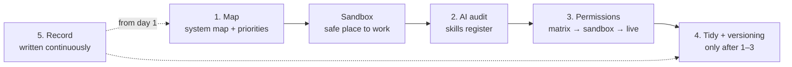

# First Stage — Detailed Breakdown + First Month Checklist

**Tacit Padel × Notion — the proposal's first stage, expanded**

*Five work items, what each actually means, and the week-by-week plan to execute them*

The first stage is to understand and improve Tacit's Notion environment — not customer-facing applications. The first milestone is an internal Notion system that is organised, understandable and useful to the team. Specific database and versioning priorities get agreed together after the current setup has been reviewed.

> **How to read this**
> - **Want the plan?** → jump to the week-by-week checklist at the bottom — it's the executable part (real checkboxes).
> - **Want the detail behind an item?** → each Item section explains what it actually means, the pitfalls, and the deliverable it produces.
> - **Talking to Nick?** → the Questions-for-Nick lists inside each item are the interview prep.
> - **Measuring success?** → the Milestone section is the acceptance test to propose.

## Contents

1. Item 1 — Learn how Notion databases work
2. Item 2 — Review how Tacit uses Notion AI
3. Item 3 — Review access controls and permissions
4. Item 4 — Tidy databases, fix AI workflows, add versioning
5. Item 5 — Keep a clear record: structure, decisions, changes
6. The milestone — the acceptance test
7. Who does what — Devin vs UI
8. Execution order
9. The week-by-week plan — November 2026
10. Standing rules

---

## Item 1 — Learn how Notion databases work

**The point:** Everything else depends on knowing where the real data lives — map the source databases, their relations and their formula chains before touching anything.

*Source databases vs linked views; how the UI connects to the underlying data*

### What it actually means

Notion separates data from presentation:

- **Source database** — the actual table holding the data. Lives at a specific page. Owns the properties, the rows, the formulas.
- **Linked view** — a window into that database from elsewhere. A filtered/sorted display embedded in another page. The same source DB can appear in ten places as ten different views.
- **The UI is a lens, not the data** — filtering a view doesn't change the data; deleting a view doesn't delete the data. But deleting the source database deletes everything every linked view was showing.

### The mechanics to know cold

- **Relations** — two-way links between databases (e.g. TP: Sales ↔ TP: Events: a Sale row points at an Event, and the Event shows its linked Sales). This is how Tacit's chain works: Event → Sale → Hourly Rate → Balance Sheet.
- **Rollups** — aggregate properties pulled through a relation (e.g. 'sum of all Sale amounts linked to this Event'). Computed live — the things that break on null values. The .first()/.last() fragility behind the dead Sales Update Button lives here.
- **Formulas** — computed properties on a DB. Can't be read reliably by the API (returns opaque references — why Ivy does screenshots). Formulas live on the source DB and propagate to every view.
- **Property types** — text, number, select, relation, rollup, formula, person, date, status. Each behaves differently in the API. person and created by properties matter for permissions 3.0.
- **Templates** — pre-built page structures inside a DB (e.g. the Tasmin task template with its 'Creation Skill' notice).

### What to map specifically at Tacit

- Which of TP: Events, Sales, People, Organisations, Hourly Rate, Balance Sheet, Tasks are source databases vs views pointing at them.
- The relation graph: what links to what, and in which direction.
- Where the formula chains live — the Sales → Hourly Rate → Balance Sheet waterfall is the critical one.
- Which dashboards/views the team actually opens daily — those are the UI surfaces you can't break.

### Pitfalls to watch for

- **Deleting a 'table' that's actually the source** — looks identical to a linked view until you check. Always verify before removing anything.
- **Editing a formula property** that feeds three downstream DBs — changes cascade silently.
- **Relation vs rollup confusion** — a relation links rows; a rollup aggregates through a relation. Fixing 'the number is wrong' requires knowing which layer the bug is in.
- **Views don't protect data** — a filtered view showing 'only confirmed sessions' still exposes the whole DB to anyone with access. This connects to Item 3.

> **Deliverable:** A written system map: source DBs, their relations, their formulas, the formula chains, and which views surface them. The foundation document for everything else — and the first page of the handover record (Item 5).

*Videos to lean on: #1 (Your Notion Setup For 2026) and #2 (the 10-hour tutorial — jump to the databases/relations chapters).*

---

## Item 2 — Review how Tacit uses Notion AI

**The point:** ~40 skills inherited, migration half-done on live — audit each one: does it work, is it judgement or execution, is it worth migrating.

*Prompting, current capabilities and limitations, and how Notion's AI features are changing*

### (a) Audit the skill inventory

Tacit runs ~40 skills through one agent (HAL). For each, assess:

- **Status** — live, broken, or mid-migration? (Skills 2.0 migration is half-done on the live system — Nick's own admission.)
- **Type** — execution-only (deterministic → Worker candidate) or judgement-based (stays as AI)? The audit already classified them: SemVer Logger, duplicate checks, FX logic → Workers; Basil's person-matching, Eric's classification, Faye's framing → stay AI.
- **Prompt quality** — well-engineered (explicit assumptions, progressive disclosure, one clear job) or a bloated mega-prompt? The 'curse of instructions' — too many parallel rules = worse output — is the failure mode to look for.
- **Layer** — L1 utilities (Log Router), L2b main skills (Basil, Freya, Ivy, Eric, Faye), L3 reference pages. Naming convention: 'Name: Function', first letter alliterates with the domain.

### (b) Test actual capabilities and limits

- **AI can't read formula results** — the API returns opaque references. This is why Ivy runs in screenshot mode.
- **Formula engine null-safety** — .first()/.last() on relations statically blocked in automations; killed the Sales Update Button in April 2026; currently exposed on Confirm: Pattern B.
- **Cost model** — skills run manually through HAL = cheap. Standing/scheduled custom agents = credits. Workers = separate credits pool, cheap.
- **Linked views / layouts** — the agent API can't manipulate everything (per the Dev Day material, no linked-view or layout operations).

### (c) Track how the features are changing

- **Skills 2.0** — Library → Skills tab, skills databases with descriptions, slash-command invocation, agent auto-selection by description, Discover tab, usage counts, npx skills add export.
- **Workers** — Tool/Sync/Webhook triggers, ntn CLI, sandboxed TypeScript.
- **Agent API/SDK** — external apps can open sessions with Custom Agents; external agents (Claude, Cursor) can sit inside the workspace.
- **Memory** — the four-doc pattern (Project Brief / Where We Are / Decisions / Domain Language) for project continuity.

### (d) The Skills 2.0 migration specifically

Nick: 'I started to do the work. I was updating the live system. Didn't have a sandbox. It's got really messy.' Part of this review is a damage assessment: which skills are on the new model, which are half-converted, which broke in the transition — then decide whether to complete the migration or stabilise first. Do not continue migrating on the live system.

> **Deliverable:** A skills register — one row per skill: name, domain, status, judgement-vs-execution classification, migration state (1.0 / 2.0 / broken), fix priority. Doubles as the candidate list for future Worker work.

### Questions for Nick

- **What did you hit in the Skills 2.0 migration that made it stall?**
- **Which skills do the team actually run weekly?** *Usage counts in the Library will show this.*
- **Is the goal to finish migrating everything to 2.0, or only the ones that earn it?**

*Videos to lean on: #3 (Skills 1.0 — what you inherited), #4 (Skills 2.0 — the target), #9 (memory system), #5 (Dev Day — Workers/agents), #8 (pricing — the cost frame).*

---

## Item 3 — Review access controls and permissions

**The point:** Who sees coach pay and the balance sheet? Test row/column rules in the sandbox, find where the feature hits its limits, then lock down live.

*What can safely be restricted, and where the practical limits are*

### What it actually means

Notion's access model has three eras, and Tacit is pre-3.0:

- **Permissions 1.0** — all-or-nothing per database. Someone either sees the whole DB or nothing.
- **Permissions 2.0** — page-level access (share individual rows manually). Clunky, didn't scale.
- **Permissions 3.0** — granular database permissions: row-level rules driven by a person or created by property. Business/Enterprise only.

### The 3.0 mechanics — what to test

- **Set the base restrictive first.** Rules can only increase permissions, never reduce them. The DB default starts at No access or Can view, then rules lift specific users per row.
- **Rules are person-property-driven.** E.g. 'rows where Assignee = you → Can edit.' A coach could edit their own sessions but only view others'. Created by → Can edit is the standard intake pattern.
- **Must be configured on the source DB** opened as a full page — linked views don't show the controls. Rules then apply across all views automatically.
- **Highest permission wins.** If a group grants Full access, a page-level rule can't reduce it.
- **'Can Create Pages' toggle** (March 2026): users with No Access/View/Comment can still create rows — pairs with Created by → Can edit so they can edit what they made. Replaces forms-only intake.
- **Gotchas:** users with No access can't create linked views via /linked view — embed pre-built views in dashboards for them. Can edit content doesn't appear in page-level rules. Group mentions don't work with the 'Me' filter.
- **AI access is members-only** — guests can't use Notion AI at all.

### What to assess at Tacit specifically

- **The roles** — who needs to see what: coaches (their sessions, their pay?), ops staff (everything operational), Oscar (finance), Nick (everything), external freelancers.
- **The sensitive data** — TP: Balance Sheet, TP: Hourly Rate, TP: Sales contain coach pay and financials — the prime candidates for restriction.
- **The practical limits** — Nick's note says some restrictions 'undermine' the feature. The job: find exactly where 3.0 falls short for Tacit's intended use (property-level hiding limits, linked-view creation limits, guest constraints).

> **Deliverable:** A permissions matrix (role × database × level) + implemented rules in the sandbox first, then live — plus a written list of where the feature hit its limits.

### Questions for Nick

- **Should coaches see their own pay rates? Other coaches'?**
- **Who besides you and Oscar should see the balance sheet — anyone?**
- **Any external parties needing row-level access (partner clubs, freelancers)?**

*Videos to lean on: #7 (Permissions 3.0), #6 (2.0 — the workaround era it replaced).*

---

## Item 4 — Tidy databases, fix AI workflows, add versioning

**The point:** Remove the dead weight, fix what's actually broken (leave what isn't), and start logging every structural change — in that order.

*Clean up, get the intended workflows working, put a usable versioning approach in place*

### (a) Tidying the databases

- Remove dead/unused properties (the 'legacy properties' the job spec mentioned).
- Remove dead relations and redundant views.
- Fix naming inconsistencies.
- Clean up the half-finished Skills 2.0 migration artifacts.
- **Guardrail:** tidy in the sandbox or after a documented snapshot — the system is already mid-migration; without a before-state you can't prove what you didn't break.

### (b) Getting the intended AI workflows working

- Fix the skills that are broken (the null-safety cascade, the Ivy screenshot workaround).
- Stabilise whatever Skills 2.0 migration state Nick left mid-flight.
- Apply the 'execution → Worker, judgement → stays AI' split when deciding whether to fix a skill in place or flag it for code.
- **Don't fix what isn't broken** — the scheduled subscription auto-creates and habit chains work fine on native automation. Leave them.

### (c) Versioning approach

- **A usable convention:** every structural change (new property, changed formula, deleted relation, skill rewrite) gets logged — what changed, why, when, by whom, what version.
- **Tools exist in concept:** a SemVer Logger/Auditor skill and the Log Router utility (Wendy). Getting those working — or replacing them with something simpler people actually use — is the deliverable.
- **Versioning matters doubly:** Item 5 (handover) depends on it — the next person needs to reconstruct why the system looks like this, not just what it looks like.

> **Deliverable:** Tidied DBs + a live change log + a one-page versioning convention (when to bump, what to record, where the log lives).

---

## Item 5 — Keep a clear record: structure, decisions, changes

**The point:** Write everything down so a stranger could take over — the docs ARE the deliverable, not an afterthought.

*The handover layer — documented well enough for another person to take it over*

### What it actually means

The proposal is explicit: 'Tacit must be able to understand, maintain and hand over the work if the people involved change.' This is the anti-bus-factor requirement.

### What the record consists of

- **System map** (from Item 1) — source DBs, relations, formula chains, key views.
- **Skills register** (from Item 2) — what's live, what it does, its state.
- **Decisions log** — dated record of consequential choices and why, with superseded decisions preserved and marked. (The memory video's 'Decisions' doc pattern — applied to the workspace itself.)
- **Change log** — the versioning output from Item 4.
- **Runbooks** — 'how to do routine maintenance': add a coach, add a property safely, roll back a change.
- **Credentials/accounts inventory** — Tacit-owned GitHub, subscriptions, admin logins (all under Tacit-controlled emails, per the proposal).
- **Repo README** — for any code/Workers, linked from the Notion docs.

### Where it lives — two places, two audiences

- **In Notion** — a 'How TacitOS works' hub page the team can read (they'll never open a terminal).
- **In the Tacit GitHub repo** — code, worker versions, schema snapshots.

**The standard to hit:** a new person should be able to take over with only the docs — no access to you. If the docs can't explain it, the docs aren't done.

---

## The milestone — 'organised, understandable and useful to the team'

**The point:** These four words are the acceptance test — propose them to Nick as the definition of done.

- **Organised** — a staff member can find what they need without asking Nick; naming is consistent; no dead properties/relations.
- **Understandable** — the system map + docs explain the structure to a non-technical reader and a technical successor alike.
- **Useful** — the intended AI workflows actually run; skills aren't broken; versioning is live and being used.
- **Handover-ready** — documented to the point where Tacit can maintain it if you leave.

The proposal's framing matters here: 'We will agree the specific database and versioning priorities together after Dhiren has reviewed the current setup.' — your week-1 mapping (Item 1) produces the priority list. Sequence: map first, agree priorities, then execute.

---

## Who does what — Devin (API) vs Notion UI

| Item | Devin can do | Needs you / UI |
|---|---|---|
| 1. Databases & views | ~80% — schema dump, relation map, formula chains, written system map | Dashboard walkthrough; which views the team uses |
| 2. AI / skills review | ~60% — read all skill pages, classify, write the skills register | Running skills; Library state; usage meters |
| 3. Permissions | ~30% — draft the matrix, document limits | All rule config; role testing |
| 4. Tidy & versioning | ~60% — bulk data cleanup, property ops, Git schema snapshots = change log | Skills verification; view/dashboard structure |
| 5. Handover docs | ~90% — system map, register, runbooks, READMEs, Git history | Reviewing docs; placing them in Notion |

*Overall: Devin carries roughly 60–65% of the first-stage workload. The workflow: Devin analyses and produces → you verify and apply in the UI → Devin logs the change in Git.*

---

## Execution order

**The point:** Each step depends on the one before — map first, sandbox second, and nothing touches live without sign-off.

- **Item 1 (map)** — produces the system map + the priority list Nick agrees to.
- **Sandbox** — before any changes. Nick's Skills-2.0-on-live mess is the cautionary tale.
- **Item 2 (AI audit)** — skills register; decide stabilise-vs-complete-migration.
- **Item 3 (permissions)** — matrix first, implement in sandbox, then live.
- **Item 4 (tidy + fix + versioning)** — only after 1–3 are mapped.
- **Item 5 (record)** — written continuously from day 1, not bolted on at the end.

---

## The week-by-week plan — November 2026

**The point:** The five items sequenced into four weeks — sandbox first because Nick is mid-migration on live. This section is the executable part: every line is a real checkbox.

### Week 1 — Orientation + Safety

*Theme: read everything, change nothing*

**Monday–Tuesday — Get set up**

- [ ] Collect Tacit email + work login (provided from 26 Oct)
- [ ] Get added to the Tacit Notion workspace
- [ ] Walk through the workspace with Nick — he points out the core databases and known problem areas
- [ ] Ask for the staging/test workspace — or agree that creating one is your first task

**Wednesday–Friday — Map the system** (Item 1)

- [ ] Inventory the core databases: TP: Events, TP: Sales, TP: People, TP: Organisations, TP: Hourly Rate, TP: Balance Sheet, TP: Tasks
- [ ] Note which pages are source databases vs linked views
- [ ] List the live skills (Basil, Freya, Ivy, Eric, Log Router, Faye) and note their state — live, broken, mid-migration
- [ ] List native automations — which are live, which are dead (Sales Update Button dead since April)
- [ ] Note the Skills 2.0 migration state — what's migrated, what's half-done, what's still on 1.0
- [ ] Identify which pages/views the team actually uses day-to-day

**Document as you go** (Item 5 starts day 1)

- [ ] Screenshot key views and database schemas
- [ ] Note existing formulas and which properties they write to
- [ ] Record what's already broken or half-built — so changes later aren't blamed on you

> **End of week:** A written map of the current workspace: what databases exist, what skills/automations are live, what's broken, what's mid-migration.

### Week 2 — Sandbox + Permissions + AI Review

*Theme: set up a safe place to work, then review access and AI*

**Monday–Tuesday — Sandbox / staging**

- [ ] Create a test workspace or staging copy of the Notion environment
- [ ] Confirm what's safe to experiment on without touching live data
- [ ] Agree with Nick what 'done' looks like for the sandbox

**Wednesday — Access controls + permissions review** (Item 3)

- [ ] Map who needs to see what (coaches vs ops vs finance)
- [ ] Test Notion's Permissions 3.0 — can you hide properties within databases?
- [ ] Note where the practical limits are — what can't be restricted
- [ ] Identify which databases need tighter access (financial data, coach rates)

**Thursday–Friday — AI skills review** (Item 2)

- [ ] For each live skill: does it work? Does it have the null-safety problem? Is it on formulas or code?
- [ ] Note which skills are execution-only (good Worker candidates) vs judgement-based (stay as AI)
- [ ] Review the prompt quality — where are skills fragile or prompt-heavy?
- [ ] Flag the highest-priority skills to fix or stabilise

> **End of week:** A working sandbox, a permissions map, and a skills audit — which skills are broken, which are candidates for Workers, which stay as AI.

### Week 3 — Tidy + Versioning

*Theme: clean up what's broken, put versioning in place*

**Monday–Tuesday — Tidy the databases** (Item 4a)

- [ ] Clean up legacy/unused properties
- [ ] Remove dead relations and redundant views
- [ ] Standardise naming where it's inconsistent

**Wednesday–Thursday — Fix the broken workflows** (Item 4b)

- [ ] Prioritise: which broken skills/automations are blocking the team most?
- [ ] Fix or flag the ones that can't be fixed without code (Workers)
- [ ] Test the fixes in the sandbox first, then deploy to live

**Friday — Versioning approach** (Item 4c)

- [ ] Get a change-logging approach in place (SemVer-style)
- [ ] Get the SemVer Logger/Auditor skill working, or build a simple logging pattern
- [ ] Start recording schema changes as they happen

> **End of week:** Databases tidied, broken workflows fixed or flagged, and a versioning approach live.

### Week 4 — Consolidate + Handover Doc

*Theme: write it all down, prove the value*

**Monday–Wednesday — Handover documentation** (Item 5)

- [ ] Write the system map — databases, relationships, which pages hold real data
- [ ] Write the skills/automations register — what's live, what each does, where it's broken
- [ ] Write the change log format — how decisions and changes get recorded going forward
- [ ] Write the 'how to maintain this' guide — so another person could take it over

**Thursday — Review with Nick + Oscar**

- [ ] Walk through what was found, what was fixed, what still needs work
- [ ] Confirm what's next — is Tier 1 (Workers) on the roadmap, or apps first?
- [ ] Discuss what 'success' looks like for November — the trial-month criteria

**Friday — End of trial month**

- [ ] Confirm with Nick whether the arrangement continues past November
- [ ] If it ends: hand over the documentation, confirm no fee is charged
- [ ] If it continues: agree December priorities

> **End of week:** A complete handover document + a clear yes/no on whether the engagement continues.

---

## Standing rules — apply all month

- **Sandbox first, live second** — never test on the production workspace. If there's no staging, create one before touching anything.
- **Document as you go** — every decision, every change, every broken thing you find. This is the handover record.
- **Don't fix what's not broken** — the scheduled subscription auto-creates and habit chains work fine on native automation. Leave them.
- **Judgement stays AI, execution becomes Worker** — deterministic maths or data movement = flag as a Worker candidate; judgement calls stay as skills.
- **Report to Nick on priorities, Oscar on customer experience** — keep Nick sighted on direction even when working with Oscar.
- **No live changes without sign-off** — especially anything touching TP: Balance Sheet or the booking chain.

> **The one rule that matters most:** sandbox before changes. If you fix things on live while the system is mid-migration and something breaks, it's your mess too.

---

*First-stage breakdown + first-month checklist — working document, not a formal proposal. November 2026.*
