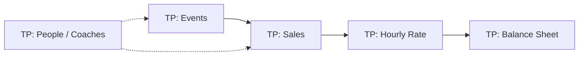
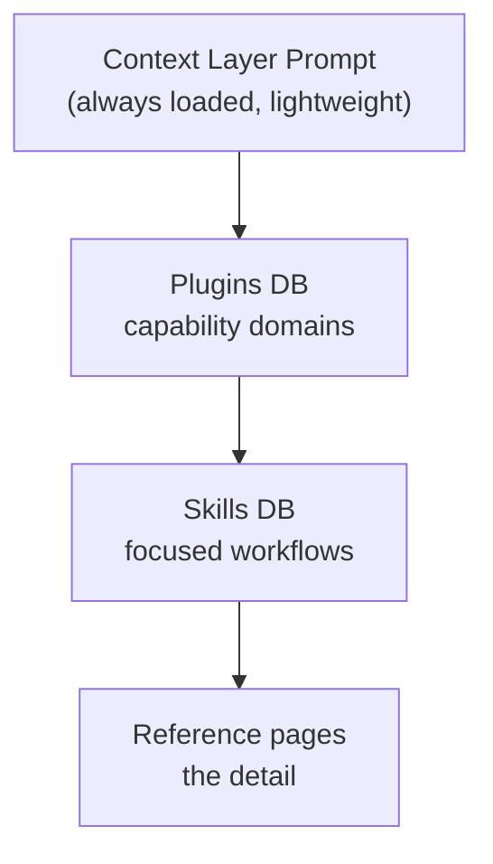
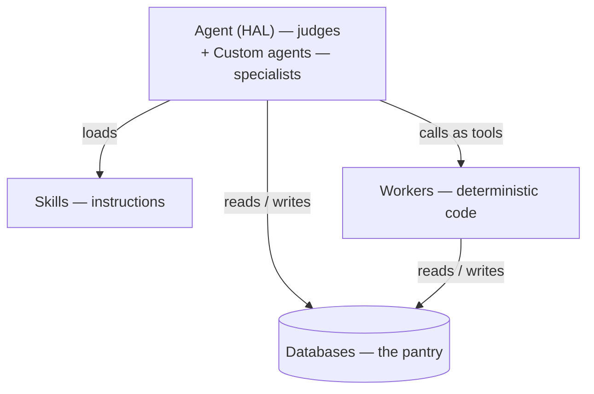

# Notion General Knowledge Base

**Tacit Padel × Notion — how the platform actually works, by topic**

A topic-by-topic reference for the parts of Notion that matter to the Tacit work. Each section opens with the point in one line and an analogy, goes deep in the middle, and ends with why it matters for TacitOS.

> **How to read this** — don't read it front to back. Pick a path:
> - **Nick / Ops** → sections 5, 6, 14 (who sees what, hiding sensitive data, what AI costs)
> - **Technical successor** → sections 2, 3, 10, 12, 18 (data model, formulas, Workers, API, backups)
> - **New team member** → sections 1, 4, 9, 11 (the big picture, automations, agents, memory)
> - **Everything else** → dip in as needed. Each section stands alone.

## Contents

1. Where does everything actually live? — The context layer
2. What's the data vs what's just a view? — Databases
3. Why do the numbers break? — Formulas
4. What can Notion do without code? — Automations & buttons
5. Who can see what? — The sharing model
6. How do you hide the pay columns? — Permissions
7. How do you teach the AI your process? — Skills
8. How do 40 skills stay navigable? — The plugin system
9. Who does the thinking? — Agents
10. Who does the doing? — Workers & the dev platform
11. Why does the AI forget? — Memory
12. What can code reach? — The Notion API
13. What do you get for free? — Page history & versioning
14. What does the AI cost? — Capabilities, limits & pricing
15. How do other AIs plug in? — MCP
16. How does it all fit together? — The four layers
17. How do docs stay current? — Wikis
18. How do you get data in and out? — Import, export & backups
19. What else exists? — Peripheral products

---

## 1. Where does everything actually live? — the context layer

**The point:** Notion is the permanent home of the data; AI tools are interchangeable visitors on top of it.

> **Analogy:** Think of a library building. The books, the catalogue cards, the meeting-room notes — all of it lives in the building permanently. Librarians (AI tools) come and go; some use the catalogue better than others, but the building is what matters. Swap a librarian and the knowledge stays.

The core idea: stop treating Notion as the place where AI happens to run, and start treating it as the **Context Layer** — the single source of truth that any AI plugs into.

- **Wrong model — 'AI harness':** the AI tool is the system. Context lives inside chats. Switch tools and the knowledge evaporates.
- **Right model — 'context layer':** Notion holds the data, projects and decisions permanently. AI tools (Notion AI, Claude, ChatGPT) are interchangeable readers/writers on top. Swap the model; the system survives.

This is the architecture Tacit's proposal already commits to — "Notion should remain the centre of the data model wherever that is practical" — and it's what makes handover achievable: if the workspace is the system, a new person inherits the whole picture.

### The Minimum Viable System — five databases

- **Projects** — high-level containers (status, duration, responsible person).
- **Tasks** — action units; checkbox for one-click completion; each related back to its project.
- **Docs** — one central repository where AI output lands rather than evaporating in chats.
- **Meetings** — the searchable log of attendees, notes and decisions — the record of why things were decided.
- **Skills** — the database of repeatable AI workflows.

### Two design principles that make AI actually work

- **Relations are the wiring.** They let the AI traverse 'this project's tasks, docs and meetings' instead of blindly searching the whole workspace — faster, cheaper, more accurate.
- **Dashboards filter noise.** Clean filtered views aren't cosmetic — they limit what the AI pulls into context. Tidying views directly improves AI answer quality.

> **Why it matters for Tacit:** The operational databases exist (Events/Sales/People/Orgs). Likely gaps to check: a Meetings/decisions database and a Docs repository where AI output is stored rather than scattered.

---

## 2. What's the data vs what's just a view? — databases

**The point:** A source database holds the real data; a linked view is only a window into it — they look identical and that confusion causes real damage.

> **Analogy:** A source database is the actual filing cabinet in the back room — the records live there. A linked view is a window cut through the wall so people in other rooms can see specific folders through it. You can tint the window, sort what's visible, or close the curtain — but you're looking at the same cabinet. Remove the window and the cabinet is untouched; remove the cabinet and every window shows nothing.

### Source database vs linked view — the distinction that matters most

- **Source database** — the actual table holding the data. Lives at a specific page. Owns the properties, rows and formulas.
- **Linked view** — a window into that database from elsewhere: a filtered/sorted display embedded in another page. One source DB can appear in ten places as ten different views.
- **The UI is a lens, not the data** — filtering a view doesn't change data; deleting a view doesn't delete data. Deleting the source database deletes everything every linked view was showing.
- **Views don't protect data** — a view filtered to 'only confirmed sessions' still exposes the whole DB to anyone with access. Access control lives at the database/row/column level, not the view level.

### Property types — the columns

| Type | What it does | Notes |
|---|---|---|
| Text / title | Plain text | Title = the row's name; text = freeform field |
| Number | Numeric values | Formatted as currency, percent, etc. |
| Select / multi-select | Pick from a list | Single or multiple options |
| Status | Workflow state | Grouped into To-do / In progress / Complete |
| Date | Dates and ranges | Can include end date, reminder |
| Person | Link to a workspace member | Drives row-level permission rules |
| Created by / time | Auto-filled on creation | Also drives permission rules |
| Relation | Link rows between two databases | Two-way — both sides see the link |
| Rollup | Aggregate through a relation | Sum, count, first, last... — see below |
| Formula | Computed value from other properties | See section 3 — API returns opaque refs |
| Checkbox / URL / email / phone / files | Simple field types | Self-explanatory |

### Relations — the wiring

- A relation links rows in one database to rows in another — two-way, both sides see the link. Tacit's chain: Event → Sale → Hourly Rate → Balance Sheet is a relation chain.
- For humans relations are navigation; for the AI they're retrieval paths — 'all tasks on project X' resolves through the relation instead of a full-workspace search.

### Rollups — aggregation through relations

- A rollup pulls values from linked rows and aggregates them: sum, count, average, min, max, first, last, 'show original'.
- Computed live — and the classic fragility: rollups over empty relations return empty, and .first()/.last() on relations is where the null-safety failures live (the dead Sales Update Button's root cause).
- Relation links rows; rollup aggregates through the relation. 'The number is wrong' debugging starts by identifying which layer the error is in.

### Views, filters, templates

- **View types** — table, board, calendar, list, gallery, timeline — different lenses on the same rows.
- **Filters and sorts** — stored per view, don't alter the data. Each view can expose a different slice to a different audience.
- **Templates** — pre-built page structures inside a DB (e.g. a task template that already contains a 'Creation Skill' notice).
- **Synced blocks** — one block that appears in multiple places and updates everywhere — useful for shared instructions/headers.
- **Chart views** — native bar/line/donut charts over a database: dashboards without exporting to a spreadsheet. Count rows by status, sum sales by month.
- **Notion Calendar** — a separate satellite app that two-way-syncs with date properties; any DB with dates can appear as a real calendar. Distinct from the calendar *view* inside a database.

> **Why it matters for Tacit:** This is Item 1's core knowledge. Week-1 mapping = for each TP: database: is it a source or a view? What relations does it hold? Where do the rollups/formulas live? Which views does the team actually use?

---

## 3. Why do the numbers break? — formulas

**The point:** Formula chains are dominoes — each level assumes the last produced a value, and one empty relation or hidden column silently cascades through the whole money chain.

> **Analogy:** Formulas are like a row of dominoes stood on edge. Each one leans on the one before it — Event feeds Sale feeds Hourly Rate feeds Balance Sheet. Tip one domino (edit a formula, hide a column, hit an empty relation) and every domino downstream falls or wobbles with no warning. There's no diagram showing which domino leans on which — you have to trace the chain by hand.

### The basics

- A formula property computes a value per row from other properties — arithmetic, text manipulation, conditionals (ifs), date maths, and pulling values through relations.
- Formulas live on the source database and propagate to every view — one edit affects every surface that shows the DB.
- Chains compound: a formula in DB A feeding a rollup in DB B feeding a formula in DB C. The Sales → Hourly Rate → Balance Sheet waterfall is exactly this — multi-tier, each level assuming the previous one produced a value.

### The limits that bite in practice

- **The API can't read formula results reliably** — it returns opaque references, not values. This is why Ivy (the invoice skill) runs in screenshot mode: the AI literally cannot see computed numbers through the API.
- **Null-safety in automations** — formulas calling .first() or .last() on relations are statically blocked inside automations. The rule: a relation can be empty, so first/last might not exist — the engine refuses to run the formula in automation context.
- **The consequence** — this is what killed the Sales Update Button in April 2026, and it's still exposed on Confirm: Pattern B. The same math works on the page but is refused inside an automation.
- **Permissions interact** — formulas respect permissions. Hide a property (Permissions 3.0) and formulas referencing it may return empty or break — test every chain after locking columns.
- **Silent cascade** — edit a formula property that feeds downstream DBs and the change ripples with no warning. There's no dependency graph shown in the UI; you have to map it manually.

### Formula 2.0 — the repair toolkit

- **let() / lets()** — name intermediate values inside a formula: compute 'gross' once, reuse it — reads like code instead of nested spaghetti.
- **map() / filter()** — operate on every row in a relation explicitly, instead of the fragile .first()/.last() grab.
- **Proper null handling** — empty() checks and ifs() fallbacks so an empty relation degrades to a safe value instead of breaking.
- **Multi-line editing** — the editor supports real expression structure; formulas are closer to small programs than spreadsheet cells now.
- **Why it matters here** — if the money chain gets patched in place before Workers arrive, this is the toolkit: named intermediates, explicit iteration, guarded nulls.

> **Why it matters for Tacit:** The formula fragility is the structural reason the money maths should eventually move to a Worker: code computes, validates and writes static values instead of relying on live formula chains that break on empty relations, opaque API references and permission changes.

---

## 4. What can Notion do without code? — automations & buttons

**The point:** Native automations handle simple 'when X → do Y' reliably — the moment a job needs loops, external calls or real conditions, that's Worker territory.

> **Analogy:** Native automations are like a vending machine: put in a specific input (a coin, a button press, a row matching a filter) and you get a specific output (a snack, a property update, a notification). Reliable, simple, no thinking. But ask the vending machine to decide what snack you'd like based on your mood, or to call the supplier when it's empty — it can't. That's the gap Workers fill: the kitchen behind the vending machine.

- **Database automations** — 'when X happens, do Y': when a page is added/edited matching a filter → set a property, add a page to another DB, send a notification. The scheduled subscription auto-creates at Tacit run on this.
- **Buttons** — one-click actions on a row or page: create linked pages, update properties, run a sequence. The Sales Update Button was a button triggering a formula-driven update — which is why the null-safety block killed it.
- **Recurring/scheduling** — automations can fire on a schedule (e.g. nightly task creation).
- **Notifications** — Slack/email/Notion notifications as automation outputs.
- **Webhook actions** — automations can also send a webhook to a third-party service when triggered — the simple no-code version of outbound notification (limited triggers; the API's connection webhooks below are the fuller version).
- **Where it stops** — no loops over rows, no conditional branching beyond filters, no external API calls, limited formula access (the .first()/.last() block). That's the gap Workers fill.

### Forms — intake without sharing

- **Native Notion forms** — publish a form backed by a database; each submission creates a row. The respondent never needs a Notion account or workspace access.
- **vs 'Can Create'** — forms are a cleaner external front door (branded, structured fields, no account needed); Can Create is for users who already have some Notion access. Same idea — intake without exposure.
- **Tacit candidates** — coach applications, venue enquiries, feedback — anything currently landing in email and being re-keyed.

> **Why it matters for Tacit:** The 'don't fix what isn't broken' rule depends on knowing which mechanism each workflow uses: healthy native automations should be left alone; dead button/formula automations are Worker candidates. Week 1 maps which is which.

---

## 5. Who can see what? — the sharing model

**The point:** Members roam, guests are room-locked, groups move as one — and a page inherits its parent's access unless you restrict it.

> **Analogy:** Think of a members' club. Members pay dues and can walk the whole building. Guests are invited to a specific room for a specific evening — they can't wander. Groups are departments (the tennis committee, the bar staff) — give the committee key access and every committee member gets in. A door left open on the ground floor means everyone upstairs is also open, unless you explicitly lock their door.

### The people types

- **Members** — paid seats; full workspace members; the only ones who can use Notion AI.
- **Guests** — free, invited to specific pages only; see exactly what's shared to them and nothing else; no AI access.
- **Groups** — named sets of members (e.g. 'Coaches', 'Ops'); access granted to a group applies to all its members — and a group grant can't be reduced by page-level rules (highest permission wins).

### How access flows

- **Sharing levels** — Full access / Can edit / Can edit content / Can comment / Can view / No access.
- **Inheritance** — a page inherits the access of its parent unless you restrict it. Sharing a parent page shares everything beneath it by default.
- **Workspace/teamspace level vs page level** — workspace-wide access applies everywhere; page-level sharing narrows to that page and its children.
- **Integration access** — API integrations are also guests of a sort: they only see pages/databases explicitly shared to the integration.

### Teamspaces — the top-level containers

- **What they are** — named compartments of the workspace (e.g. 'Coaching', 'Finance', 'Ops'), each with its own default membership — everyone, a group, or invite-only. Every page lives inside one teamspace.
- **Membership layers** — teamspace members see everything in it; open teamspaces can be browsed/joined by anyone; closed/private ones stay invisible to non-members.
- **The tidy-up tool** — if Tacit's workspace is flat page sprawl, teamspaces are the structural fix: one per function, with permissions handled at the container level instead of per page.

### The collaboration layer — comments, mentions, notifications

- **Inline comments** — anchored to a block or a whole page; threads resolve when done. The record of discussions attached to the thing discussed.
- **@mentions** — people, pages, dates; mentioning a person notifies them and links them to the spot.
- **Notifications** — the inbox for mentions, comments, access requests, automation outputs; configurable per page ('follow'/'unfollow'). Now also forwards to Microsoft Teams.
- **Why it matters** — adoption mechanics: a tidy system people aren't notified about doesn't get used; comments keep discussion inside the record instead of in WhatsApp.

### Notion Sites — sharing outside the workspace

- **Publish pages to the web** — any page can become a public URL; a 'Site' is a multi-page published collection with its own domain, navigation and theming.
- **Column permissions still apply** — hidden properties stay hidden from public viewers — the mechanism for sharing a filtered slice of data externally.
- **Paid extras** — custom domains and SEO controls sit on higher plans; basic publishing is broadly available.
- **Tacit candidates** — public class timetables, venue info, a help centre — anything currently duplicated onto a website by hand.

> **Why it matters for Tacit:** Item 3's foundation: you can't assess what to restrict until you know who currently has what — members vs guests, which groups exist, and which top-level pages are shared broadly (since everything beneath them inherits).

---

## 6. How do you hide the pay columns? — permissions

**The point:** Access control evolved from all-or-nothing databases to column-level hiding — and rules only ever raise access, so you always start restrictive and opt people back in.

> **Analogy:** Imagine a hospital records room. 1.0: either you have a key to the whole room or you don't. 2.0: you get a key to a specific patient's file. Row-level rules: anyone assigned as a patient's doctor automatically gets that file. 'Can Create': a referring GP can drop a new file through the slot without seeing any existing files. 3.0 (column-level): everyone with access to a file can read the diagnosis, but only HR can see the salary field — a redacted copy per reader, controlled per column.

### The three eras

- **1.0** — all-or-nothing per database: you see the whole DB or nothing.
- **2.0** — page-level access: share individual rows; possible but manual and clunky.
- **Granular row-level rules** — rules driven by a person property or 'created by': 'rows where Assignee = you → Can edit'. Set on the source DB; apply across all views automatically. Rules only ever increase access — never reduce it — so the base must start restrictive. Highest permission always wins.
- **The 'Can Create' update** — create entries in a DB you have No Access to (below).
- **3.0 — column-level** — hide specific properties inside a database (below). Business/Enterprise only.

### 'Can Create' — intake without access

- **Create with No Access** — add rows to a DB you can't otherwise see. Notion auto-suggests a matching rule (Created by → Can edit) so creators can edit their own submissions.
- **External collaboration** — a guest adds entries through a shared linked view, never seeing the source DB or other rows. Brief sync delay after creating; a refresh resolves it.
- **Internal pattern** — lock the DB down (revoke default access), give a group 'Can Create', then a database automation grants team access to each new entry.
- **Database buttons** — e.g. a 'Lock for HR' button that flips a row's permissions in one click.
- **Limitation** — users without source-DB access can't create linked views via the slash command; they duplicate a view you provide.

### Column-level permissions (3.0) — shipped October 13, 2026

- **Setup** — click a property → 'Property access'. Per column or multiple at once.
- **Default levels** — baseline per column: No access / Can view / Can edit content.
- **Exceptions** — lift access for specific people, groups, or a Person property (e.g. the row's Owner sees the sensitive field).
- **Preview mode** — the eye icon simulates any user's view before committing. Always preview.
- **Hierarchy** — column rules don't override row access. Row first, columns second.
- **Waterfall principle** — restrictive default + opt-in exceptions; never rely on rules to reduce broad access.
- **Formula gotcha** — formulas respect permissions: hide a property and formulas referencing it may return empty or break. Verify every chain after locking columns — the money chain is exactly what this could silently break.
- **Linked view bug** — a known quirk: some permission edits only configure properly through a linked view.
- **Agents and integrations** — column rules also constrain what integrations and AI agents can edit.

**AI warning** — Notion AI sees everything the user sees. Permissions discipline governs what the AI can pull into answers, not just what people browse.

### The eras at a glance

| Aspect | 1.0 — DB-level | 2.0 — page/row | Row-level rules | 3.0 — column-level |
|---|---|---|---|---|
| What it controls | Whole database | Individual rows/pages | Rows matching a rule | Specific properties in a DB |
| How it's granted | Share the DB or don't | Share each row manually | Person / created-by property drives the rule | Property access per column + exceptions |
| Scales? | Yes — but too coarse | No — manual per row | Yes — automatic as rows arrive | Yes — applies to all rows |
| Typical use | Everyone sees a DB, or no one does | Share one client record with one person | Coaches edit only their own rows | Hide coach pay / FX columns by role |
| Reduce access? | Base level itself | Base level itself | No — rules only raise access | Yes — sets the baseline per column |
| Main limit | All-or-nothing | Clunky at scale | Can't reduce broad grants; linked-view creation quirk | Business/Enterprise only; formula-permission interaction; row access required first |
| Tacit fit | Current default | Too manual for 100s of rows | Coach self-service views; intake patterns | The feature Nick wants — hiding pay/finance columns |

*'Can Create' is an update layered on top of row-level rules: create rows in a DB you can't see, paired with a Created-by rule so you can edit your own submissions.*

### Admin & security controls — the governance layer

- **SAML SSO + SCIM** (Enterprise) — single sign-on and automatic user provisioning/deprovisioning; people joining/leaving is managed from the identity provider, not manually.
- **Audit log** (Enterprise) — a record of admin and security-relevant actions (key changes, sharing changes, exports, BYOK key rotation). Feeds the versioning story at workspace level.
- **Domain management** — claim company email domains; control which workspaces company accounts can join.
- **Workspace analytics & content search** — admin-level views of usage and the ability to find content across the workspace.
- **Connection controls** — admins decide which integrations/MCP tools people may connect (Notion-verified only, or an allow-list).

> **Why it matters for Tacit:** Two complementary tools: 'Can Create' for intake (add rows you can't browse) and column-level rules for hiding sensitive fields (coach pay, FX rates, balance-sheet figures). Top testing priority: the formula-permission interaction — it touches the money chain directly.

---

## 7. How do you teach the AI your process? — skills

**The point:** A skill is a Notion page of reusable instructions — the craft is in writing them lean, explicit and focused on one job.

> **Analogy:** A skill is a recipe card in a kitchen. 1.0: recipes handwritten on index cards, stuffed in drawers — you have to know which drawer. 2.0: a proper recipe binder with tabs, an index, usage notes ('made this 12 times'), and the head chef can pin a 'house standard' recipe that every cook sees. The Skills API lets you photocopy a card and hand it to the chef next door (Claude, Cursor) so they cook the same way.

### What a skill is

A Notion page containing reusable instructions for the AI. When the agent needs a repeatable job done — classify an expense, update a sales record, generate an invoice — it loads that page's instructions and follows them.

- **Write once, reuse forever** — a good instruction beats re-explaining the job every session.
- **It forces assumptions into the open** — every 'obviously I mean X' must be written down; the AI can't guess. Skills double as process documentation.
- **The 'curse of instructions'** — one giant 'do everything' prompt degrades output; small focused skills loaded when needed beat one master prompt.
- **Progressive disclosure** — load only the instructions the job needs; the principle the whole skills architecture is built on.
- **Skills are just pages** — they inherit everything Notion pages can do: link to docs, attach files, live in databases with properties.

### Skills 1.0 — the original model (what Tacit inherited)

- A skill was a page with instructions — no special marking, no library.
- Invocation was manual: the @-add method, or pointing the agent at the page.
- Skills could be scattered anywhere — no canonical home, no inventory, no usage tracking.
- Quality depended entirely on writing craft — 'skill engineering' was a discipline, not a product feature.
- Tacit's ~40 skills (Basil, Freya, Ivy, Eric, Faye, the Log Router...) were built on this model — 'Name: Function' naming, L1 utilities / L2b main skills / L3 reference layers.

### Skills 2.0 — the platform (the migration target)

- **Skills Library** — a dedicated Skills tab in the Library: see enabled skills, discover shared ones.
- **'Use with AI skill' marking** — any page can be designated a skill, then enabled.
- **Slash commands** — enabled skills appear in the / menu where you're working.
- **Auto-selection** — the agent can pick a skill when its description matches the request — so descriptions must be clear and distinct.
- **Auto-execution** — skills can trigger automatically for recurring jobs. Caution: adds context load; deterministic recurring jobs are usually Worker candidates anyway.
- **Discover + usage counts** — the Library shows how often each skill is invoked — audit evidence for which earn their place.
- **Centralised Skills Database** — one structured DB, a row per skill (description, files, tags) — auditable as a table.
- **Default Workspace Skills** — admin-set skills applied to the whole team's AI; the feature that turns skills into org-wide infrastructure.
- **Skills API** — write a skill once in Notion, sync it to GitHub as a SKILL.md file for Claude Code, Codex, Cursor, Gemini, Grok. Notion shows an 'out of date' badge when the Notion copy changes.

### 1.0 vs 2.0 at a glance

| Aspect | Skills 1.0 | Skills 2.0 |
|---|---|---|
| Where skills live | Scattered pages anywhere | Library → Skills tab; one structured Skills Database |
| Becoming a skill | By convention only | Marked 'Use with AI skill', then enabled |
| Invocation | @-add / manual pointing | Slash commands; auto-selection; optional auto-execution |
| Discovery | You had to know they existed | Discover tab + usage counts |
| Team consistency | Per-user configuration | Default Workspace Skills — admin-set for all |
| Outside Notion | None | SKILL.md export for Claude Code, Codex, Cursor |

### Skill engineering — how to write a good skill

*The craft layer — applies regardless of 1.0 or 2.0*

**The three-tier context model**

- **Always loaded** — personal instructions / the agent's instruction page. Should be **lightweight**: identity, standards, how to work the system. Whatever sits here taxes every single conversation — keep it small and push detail out to skills and references.
- **Skills** — loaded on demand when the job matches the description.
- **Reference docs** — loaded on demand by skills that point to them (L3 pages at Tacit).

**The five levels of skill writing**

- **L1 — No skills:** every interaction starts from scratch.
- **L2 — Blind delegation:** ask the AI to write the skill with zero context.
- **L3 — Manual writing:** write it yourself from conscious knowledge — still misses hidden assumptions.
- **L4 — Co-creating with AI (AC/DC):** surface what you don't know you know.
- **L5 — Co-creating with structure:** AC/DC + a Skill Document Framework + meta-prompting.
- Levels 1–3 share the same failure mode — **the hidden assumptions gap**: the expert's tacit knowledge never makes it onto the page, so the AI fills it with guesses.

**The AC/DC loop — how a skill actually gets built**

- **Assess** — map the real workflow as it actually happens, not as it's supposed to.
- **Collaborate** — messy first pass with the AI; watch where it fails — the failures reveal the missing assumptions.
- **Draft** — structure the skill from what the first pass exposed.
- **Certify** — test in production, fix, re-test.
- Framing: **Discover → Codify → Ship**. And the level-5 lifecycle wraps it: AC/DC → Skill Creator → Skill Reviewer → Skill Compounder — skills that create, review and improve skills.

**Writing rules that actually change output**

- **Skip the persona.** 'You are an expert marketer' adds confidence to the voice, not value to the answer. Instead state **what good looks like** and **the process to follow** — make the AI reason through your actual workflow rather than giving it a generic situation to act out.
- **Keep the skill page lean and high-level** — goal, output, and why. Detail lives in linked reference docs loaded on demand, not packed into the skill itself.
- **Attention is positional** — the first and last parts of a prompt get the most attention; the middle tends to get muddy. Put critical constraints at the top, the output definition at the bottom, and don't bury key rules mid-page.

> **Why it matters for Tacit:** The migration target: one Skills Database in the Library, clear descriptions, workspace defaults for shared rules — not forty scattered pages. And when auditing Tacit's skills, the quality bar is the engineering rules above: lean page, explicit assumptions, real process, critical rules at the edges. Migration damage assessment is a week-2 task; don't continue migrating on the live system.

---

## 8. How do 40 skills stay navigable? — the plugin system

**The point:** A set of linked databases (Plugins → Skills → Agents) whose descriptions form a discovery chain the AI walks on demand — progressive disclosure as a data model.

> **Analogy:** Think of a department store. The ground-floor directory board (the CLP) doesn't list every product — it lists departments: 'Toys, 3rd floor; Kitchenware, 2nd floor.' Each department's sign (the plugin description) tells you whether to go up. Once on the floor, aisle markers (skill descriptions) lead you to the shelf; the product packaging (reference docs) has the detail. You never carry the whole store in your arms — you walk the signs.

### What it is

Once you have more than a handful of skills, folders aren't enough — you need a structure the AI itself can navigate. The Plugin System groups related capabilities under named domains, so the Context Layer Prompt (CLP — the always-loaded instruction page) can point to a Plugins database and let the AI discover what's available on demand.

### The three core databases

- **Plugins** — one entry per capability domain (e.g. 'Skill Engineering', 'Client Onboarding'). Each plugin's description acts as the trigger mechanism for the AI — the description is how the agent decides whether a domain is relevant.
- **Skills** — individual skill pages with focused instructions for one workflow; each relates to one or more plugins.
- **Agents** — AI agents that use skills and belong to plugins — the bridge between skills and automated execution.

### The discovery chain

- **CLP → Plugin description → Skill description → Reference pages.**
- Each level's description is a discovery mechanism: the CLP says 'check the Plugins database for relevant capability areas'; the matching plugin's description points to its skills; each skill's description points to its references.
- Result: a lightweight auto-loading architecture built entirely from Notion-native building blocks — the agent walks the chain on demand instead of loading everything up front.

### Extending it — same pattern, new object types

- **MCPs** — Model Context Protocol connections to external tools.
- **Workers** — background automation agents registered alongside the skills they serve.
- **Tool Configurations** — external tool setups and API keys.
- **Reference Libraries** — style guides, examples, edge-case collections.
- One database per object type, interlinked. The relational structure absorbs new capability types without redesigning anything.

> **Why it matters for Tacit:** This is essentially the mature form of what Tacit's L1/L2b/L3 layers approximate — capability domains as plugins (Bookings, Finance, Comms, People Ops), skills related to them, agents registered to them, and description-driven discovery matching Skills 2.0 auto-selection. Also the natural registry for Workers and API keys when Tier 1 arrives.

---

## 9. Who does the thinking? — agents

**The point:** Agents are the judgement layer — HAL is the generalist, custom agents are configured specialists, and every call costs credits.

> **Analogy:** HAL is the hotel concierge — knows the building, can handle almost any request, and pulls out the right guidebook (skill) when needed. A custom agent is the specialist you call in: the spa manager, the events coordinator — narrower expertise, deeper in one area. Auto (the model router) is the concierge deciding whether your question needs the junior clerk or the senior manager — matching the task to the right level without you choosing.

### The actors

- **The agent (HAL at Tacit)** — the main AI actor: reads skills, interprets requests, makes judgement calls. Where ambiguity lives by design.
- **Custom agent** — a narrow, task-specific agent configured for one job — a specialist vs HAL's generalist.
- **Standing vs on-demand** — a standing/scheduled agent burns credits continuously; a skill run manually through a person's session is cheap. This cost difference is why Tacit runs 40 skills through HAL on demand rather than deploying standing agents.

### Custom Agents — the configured specialist

- **What it is** — a saved agent configuration: a name, a set of instructions, access to specific pages/databases, a chosen set of tools and skills, and a model. Anyone on the team can invoke it without knowing how it was built.
- **Configuration surface** — instructions (its job and how to do it), knowledge access (which pages/DBs it can see — its own permission scope), tools/skills it may use, the model it runs on, and its trigger.
- **What 'tools' an agent can hold** — native Notion actions (search, read, create/update pages and DB rows), skills from the Library, MCP connections to external tools (HubSpot, Stripe, GitHub…), and **tool-type Workers** — code the agent calls like a function for deterministic jobs. The agent decides *when*; the tool does *what*.
- **Triggers** — manual (a person chats with it), scheduled (runs on a timer), event-driven (e.g. a meeting ending — Business/Enterprise), or embedded (sits in a doc for anyone on that page), or called by another agent (sub-agent).
- **Who pays** — by default the *owner's* Select credits, even when teammates use it; admins can fund an agent from the shared workspace Notion credits instead, with per-agent budgets.
- **Vs a skill** — a skill is just instructions; a custom agent is instructions + access + tools + model + trigger, packaged as a named actor. A skill runs inside *your* session on *your* credits; a custom agent is a standing configuration others invoke.

### Agents rebuilt (October 19, 2026)

- **Own computer and browser** — agents can now interact with external tools and pages directly, not just Notion content.
- **24-hour tasks** — agents can work on long-running tasks for up to 24 hours.
- **'Review for me' mode** — a safety-check mode that reviews agent output before it's committed.
- **Smarter context management** — the new harness keeps complex tasks focused and credit-efficient with fewer wasted steps.
- **50% faster chat loading** on mobile.

### Auto — the model router (October 19, 2026)

- **Auto matches each task to the model** that best balances quality, speed and cost — you don't pick the model yourself.
- **Cost claim:** similar results to Opus 5.5 / Astra at ~90% lower average cost. Credits go ~10× further across 20+ common tasks.
- **Relevance:** if Tacit runs many agent interactions, Auto could replace manual model picking and significantly reduce credit consumption.

### The routing pattern — 'Nimbus' as the reference design

- **One agent, many skills** — a central agent acts as router, loading only the instructions a request needs — progressive disclosure at agent level. No mega-prompt. HAL already works this way.
- **Two entry points** — autonomous team co-worker, or a tool inside an individual's own workflow. The personal-workflow mode saves credits.
- **Four DBs around it: Docs, Questions, Skills, Tasks** — the agent logs its own performance, flags missing info, assigns human follow-ups.
- **The self-improvement loop** — every unanswered question logged in the Questions DB; the agent drafts fixes or flags humans. Usage reveals gaps; gaps become work.
- **Human review gates** — the agent can't write changes straight in; a human approves first. Prevents 'AI generates noise faster than people review'.
- **LLM-wiki interlinking** — docs cross-linked like Wikipedia so future agents crawl context by following links.
- **Three data buckets** — native (in Notion), mirrored (synced in from other tools), external (stays elsewhere, queried via AI tools, e.g. GitHub).

> **Why it matters for Tacit:** Nimbus is HAL's direction, not a different system. Tacit's likely missing pieces: the Questions log (turn every gap into follow-up work) and human review gates — the compounding-improvement machinery.

---

## 10. Who does the doing? — Workers & the developer platform

**The point:** Workers are hosted TypeScript — deterministic code that never hallucinates, costs a fraction of an agent run, and fills the gap between native automations and Make/Zapier.

> **Analogy:** Workers are the kitchen equipment — the ovens, the dishwashers, the timers. They don't taste the food or decide the menu (that's the chef/agent). They do exactly what they're built to do, every time, without judgement. A webhook Worker is the service bell — rings when an order arrives. A sync Worker is the delivery truck that shows up on schedule. A tool Worker is the thermometer the chef calls for when they need a precise reading. Cheap to run, never improvises.

### What a Worker is

A Worker is a small piece of code (TypeScript, running on Node) that you write locally and deploy to Notion's hosted infrastructure — like AWS Lambda but living inside your workspace. It fills the gap between native automations (limited: no loops, no external calls, formula blocks) and external glue tools like Make/Zapier (duct-tape outside the platform).

- **It is code, not AI.** No reasoning, no judgement — it does exactly what it's written to do, every time. That determinism is the point: code doesn't hallucinate, and it's auditable because it's versioned.
- **It's cheap.** A Worker run costs a fraction of an agent execution — the agent reasons token-by-token; the Worker just runs. Notion's own guidance: use code for the deterministic parts and agents for the judgement calls — claimed to cut agent token costs 80%+.
- **It's sandboxed.** Runs on Notion's servers with access to the workspace via the API surface — not arbitrary code on your machine.

### The three trigger types — how a Worker fires

- **Tool** — an agent calls the Worker like a function, passing inputs and getting structured output back. The 'AI decides, code executes' split made concrete: HAL (or a custom agent) judges *that* a compensation figure needs computing; the Worker computes it.
- **Webhook** — the Worker answers an inbound HTTP call from an external system. E.g. Courtside posts 'booking cancelled' → the Worker receives it, verifies the signature, updates the row.
- **Sync** — runs on a schedule (e.g. every 15 minutes) pulling external data in. The polling counterpart to webhooks: instead of being told about changes, it asks for them.
- **Both directions exist** — a webhook Worker receives events *into* Notion; the API's connection webhooks (section 12) push events *out* of Notion when pages/databases change.

### Real examples from the launch material

- Company enrichment — fetch logos / scrape company sites and fill properties automatically.
- Automatic task generation — create the right task set when a project of a given type is created.
- Duplicate checker — scan People/Organisation databases for near-duplicates and flag/merge them.
- Overdue escalator — scheduled check that escalates stale tasks.
- External data sync — Stripe invoices, meeting notes, Jira/Salesforce pulls into Notion.

### Sync workers — the specialised type for external data

- **One-way sync into a locked, protected database** — the external source stays the source of truth; synced fields can't be edited in Notion. Edit attempts are prevented, not just discouraged.
- **Add your own Notion-native properties on top** — owner, tags, relations, notes — editable alongside the locked synced fields.
- **Courtside implication:** synced bookings would land in a Worker-managed DB with locked fields — not straight into TP: Events. Getting bookings into the existing sales chain means mapping/relating records from the synced DB to Tacit's own databases — a design decision, not a copy-paste.

### Synced databases — rebuilt October 13, 2026

- **Live one-way sync from GitHub, Jira and Salesforce** into Notion databases. Synced fields are read-only; you add your own properties, views, relations and automations on top.
- **Health status per sync** — the Your Syncs tab shows last sync time and health for each connection.
- **Works like any other Notion database** — add properties, create views, trigger automations, hand to agents.
- **For unsupported sources (like Courtside):** Notion's own guidance is to use Workers to build a custom sync. The managed syncs are GitHub/Jira/Salesforce only; everything else is a Worker job.
- **Legacy Salesforce connector** stops updating October 30, 2026 — migrate to the new sync by then.

### How you build and deploy — the ntn CLI

- **ntn** is Notion's command-line tool: scaffold a Worker, develop locally, deploy to the workspace, manage secrets and inspect runs/logs.
- **Development flow** — write the code in a normal repo (Git → Tacit's GitHub org), test locally where possible, deploy via CLI. Worker code is just a project — the handover story for code is a repo + README, not Notion pages.
- **Environment questions that still need answering** — can Workers run locally with mock data? Does ntn support dev→staging→prod promotion, or one workspace per deploy? Are secrets namespaced per environment? These gate how safe financial writes (M3) can be tested.
- **Plan requirement** — Business plan required; Workers live under Settings → Features → Workers.

### What Workers can't do

- No AI judgement inside a Worker — it's deterministic code; anything requiring interpretation stays in the agent layer.
- Can't manipulate views/layouts — same API limits apply.
- Still in public beta — the feature set, pricing and environment support are moving; verify capabilities before designing against them.

### The Tacit candidate list — what maps to Workers

| Candidate | Why it's a Worker job | Current state |
|---|---|---|
| Compensation waterfall | Deterministic maths (40/30/15/15 splits, deductions) | Fragile formula chains; M1 compute-only, M3 writes |
| Courtside sync | Scheduled external pull + webhook events | Manual re-keying today; needs API access confirmed |
| Duplicate checker | Rule-based matching on People/Organisations | Manual checking today |
| FX rates (Freya) | Deterministic conversion + static writes | Skill today — formula-dependent |
| SemVer logging/audit | Mechanical record-keeping | Skill concept exists |
| Sales reconciliation | Sum-of-parts = gross checks, halt on mismatch | Doesn't exist yet — M3 requirement |

### Agent SDK and Agent API

- **Agent API** — external apps can open a session with a Custom Agent, send messages and read replies programmatically. Your app drives Notion agents without a person in the chat. Public beta.
- **Agent SDK** — build with Notion agents from your own code/environment (alpha at Dev Day, public beta since Notion 3.7 in September). Query Notion context and drive agent workflows without leaving your tool.
- **Sub-agents** (Sep 2026) — a Custom Agent can call other Custom Agents, each with its own instructions, context, access and model.
- **Meeting-triggered agents** (Sep 2026) — pick which meetings trigger a Custom Agent; it receives the transcript and summary automatically (Business/Enterprise).
- **Embedded agents** (Sep 2026) — place a Custom Agent inside any doc for anyone on the page to use.
- **How it relates to MCP:** the Agent API/SDK are for driving *Notion* agents from outside; MCP is the two-way context-sharing channel between Notion and external tools/agents. Overlapping territory — check which pattern fits before building.

### Platform implications

- **Notion is positioning as the orchestration layer** — a company's system of record and context hub.
- **It requires the CLI** — Workers are deployed/managed via command line (ntn).
- **Less duct-tape** — automation that needed Make/Zapier runs natively and versioned inside the platform.

> **Why it matters for Tacit:** The technical foundation for Tier 1: Workers = deterministic execution (cheaper than agents), Sync = how external data (Courtside) arrives, CLI = the tooling. Confirms the architecture rule: judgement in agents, repeatable work in code.

---

## 11. Why does the AI forget? — memory

**The point:** Every AI chat starts blank — the four-document system gives each project a permanent briefing the AI reads before every session.

> **Analogy:** Imagine a night-shift handover in a hospital. The Lake is the medical textbook — it doesn't change between shifts. The River is the patient's chart at the bedside — updated hourly, read first thing. The four documents are: the admission brief (what we're treating), the current chart (where the patient is right now), the decisions log (why we changed meds and when), and the glossary (so 'BP' means blood pressure, not base pay). Without the handover, each new shift starts from scratch.

### The problem

Every new AI chat starts blank. The agent can search the workspace, but reconstructing project state from scattered pages burns tokens and produces inconsistent context — you end up re-explaining the project every session.

### The three components of a useful AI setup

- **General instructions** — identity and goals, loaded into every conversation.
- **Skills** — action processes; the 'how'.
- **Memory** — situational 'where we are' context. The layer most setups are missing.

### Lake vs river — the key distinction

- **The Lake** — permanent knowledge: org goals, wikis, reference material. Changes slowly.
- **The River** — fast-moving project context: what's true right now, open loops, next actions. Changes daily — needs snapshots, not a wiki.
- The mistake: keeping river-state in lake-storage. Scattered pages force the agent to re-derive current state every session.

### The four documents — per project

- **Project Brief** — scope, objectives, success criteria. Rarely updated.
- **Where We Are** — a snapshot of current status, open loops, next actions; updated frequently as a 'cold handoff' briefing.
- **Decisions** — a chronological log of what was decided and why; superseded decisions kept and marked.
- **Domain Language** — a vocabulary guide to ensure consistent terminology.

### The workflow — seed, ground, update

- **Seed** — at project start, a skill generates the four documents with initial context.
- **Ground** — before each session, a 'grounding' skill pulls current state so the AI starts up to speed.
- **Update** — at session end, 'Where We Are' and 'Decisions' get refreshed so the river stays current.
- **Meeting notes** — transcripts distilled into the four docs rather than left raw.
- **Cross-tool** — the same pages work for Claude/ChatGPT — point external tools at them for identical context.

### MCP memory sync (October 19, 2026)

- **Memory sync is now live via MCP** — external agents (Claude, ChatGPT, etc.) can read and update Notion memory documents directly, so the 'river' stays current regardless of which AI tool was used.
- **Skills via MCP coming soon** — the same channel for skills, not just memory.

> **Why it matters for Tacit:** Directly usable for the handover requirement: the four-doc pattern IS a handover record — brief, current state, decisions, vocabulary. Also gives HAL continuity. Nick hit a blocker implementing it — ask what before building it in.

---

## 12. What can code reach? — the Notion API

**The point:** The API moves data in and out but can't read formula results, can't build views, can't configure permissions — that boundary defines what automates and what stays manual.

> **Analogy:** The API is a librarian who can fetch any book, add new books, and reshelve them — but can't read certain pages (formula results are sealed), can't rearrange the reading room (views/layouts), can't hire staff (configure skills/permissions), and can't hold a conversation with a reader (run AI). For anything requiring those, you walk into the library yourself and do it at the desk.

### How access works

- **Integration tokens** — an internal integration gets a secret token; it only sees pages/databases explicitly shared to it.
- **Reads** — database schemas, properties, rows, page content (blocks), users.
- **Writes** — create/update rows, create pages, update property values, archive content. Real writes — same caution as manual edits.

### The limits that matter

- **Can't read formula results** — returns opaque references, not values (why Ivy screenshots).
- **Can't create linked views or manipulate layouts** — view/dashboard work is UI-only.
- **Can't run AI** — the API moves data; it doesn't invoke skills or agents.
- **Can't configure Skills 2.0** — marking/enabling skills, the Library, Discover — UI features.
- **Granular permission rules are configured in the UI** — you can read sharing state, but row/column rule setup is manual.
- **Rate limits and structure** — paginated reads; bulk operations need batching.

### Connection webhooks — the outbound direction

- **Notion → external** — an integration can subscribe to workspace events: page.created, page.content_updated, database schema changes and more. Notion POSTs a signal to your public HTTPS endpoint.
- **Signal, not payload** — the event says *what changed* (entity ID + type), not the content; you call the API to fetch the new state.
- **Setup** — created in the integration's Connections settings, verified with a token handshake; needs a secure public URL (no localhost).
- **vs Worker webhook triggers** — Worker webhooks are inbound (external system → Notion). Connection webhooks are outbound (Notion → your endpoint). An event-driven Worker can also be the receiving end of an automation webhook action.
- **Not covered** — user/membership and workspace-settings changes don't emit webhooks; the audit log covers those.

### Recent API changes (October 2026)

- **Status default_option** (Oct 22) — status properties now expose the default option name in the API (SDK v5.28.0). Look it up in options rather than assuming the first is default.
- **show_data_source_title** (Oct 20) — database create/update and create-view now accept this flag to show/hide the title above database views.
- **Separate search tools in MCP** (Oct 20) — notion-search now searches only Notion pages/databases; notion-connector-search searches connected sources (Slack, Google Drive, GitHub, mail, calendar). notion-ai-search is deprecated from tools/list but still callable.
- **Partial update_content edits** (Oct 16) — finer-grained content updates via the API.

> **Why it matters for Tacit:** This boundary defines the Devin-vs-UI split: analysis, bulk data ops, schema dumps, and Worker code are API-side; views, permissions config, skills setup, and running the AI are UI-side.

---

## 13. What do you get for free? — page history & versioning

**The point:** Notion records every page edit and lets you restore — but that's a safety net, not a change-management system; the deliberate change log still needs building.

> **Analogy:** Page history is a time machine for individual pages — you can rewind to yesterday's version and restore it. But it's not a project changelog: it doesn't say 'we restructured the finance database on Tuesday because of the audit.' That's like having security-camera footage of every room but no shift log explaining why the furniture was moved. You need both — the footage (page history) for recovery, the shift log (SemVer change log) for understanding.

- **Page history** — every page keeps a version history; you can view and restore previous versions (retention varies by plan).
- **Trash recovery** — deleted pages go to trash and can be restored — an accidental delete isn't automatically fatal.
- **Upgraded version history** (Oct 13, 2026) — clearer records across pages and databases, with highlighted edits, detailed database changes, and attribution (who changed it). Restore prior versions in one click. Now tracks both people and agents making changes — important when agents are editing autonomously.
- **What it doesn't do** — no schema-level changelog, no semantic versioning, no 'what changed in this database structure last month' report. Page history tracks content, not structure or decisions.
- **The gap the SemVer approach fills** — a deliberate change log: what structural change was made, why, when, by whom. That's the versioning Item 4 asks for — it doesn't exist natively.

### Page analytics — usage evidence

- **Per-page stats** — view counts, unique viewers, last viewed — visible on any page.
- **Tidy-up value** — distinguishes dead pages from quietly critical ones during cleanup; 'nobody has opened this in 6 months' is archiving evidence.
- **Workspace analytics** (admin) — aggregate adoption view: active users, most-viewed content.

> **Why it matters for Tacit:** Page history is a safety net, not a versioning system. The change-logging convention still needs to be built — but knowing history/trash exist changes how scary rollback is.

---

## 14. What does the AI cost? — capabilities, limits & pricing

**The point:** AI is members-only on Business/Enterprise, billed through three credit pools — Standard (Notion picks the model), Select (you pick), and top-up Notion credits.

> **Analogy:** Notion AI pricing is like a utility bill with three meters. The Standard meter (1,500 units) runs when Notion picks the appliance — cheap, automatic. The Select meter (500 units) runs when you pick a specific appliance or run a custom one. The Notion meter is the top-up tank the building manager buys when the first two run dry. BYOK is installing your own solar panels — the electricity runs on your account, not the utility's. The AI Command Center is the smart-meter dashboard showing who used what, and letting you cap the spend.

### Capabilities

- **Reads** — unstructured page content (text blocks), database rows via Q&A, and (through connectors) external sources like Slack/Google Drive.
- **Doesn't read formula results** — the same opaque-reference limit as the API.
- **Meeting notes** — transcription/summarisation exists natively.
- **Acts** — writes content, fills properties, works where you invoke it; can't manipulate linked views/layouts (per the Dev Day material).
- **Sees what you see** — the AI's access mirrors the user's permissions; loose permissions = loose AI.

### AI connectors & Enterprise Search

- **Connectors pull external sources into Notion AI's reach** — Slack, Google Drive, GitHub, Gmail, calendar, Jira, Salesforce and more; the AI answers across all of them with citations.
- **Enterprise Search** — the cross-source search surface; in MCP this is now split: notion-search (workspace only) vs notion-connector-search (connected sources).
- **Permission-mirrored** — the AI only sees what the asking user can see in each connected source; a sloppy Google Drive is a sloppy AI answer.

### Pricing and access

- **Bundled in Business/Enterprise only** (~€19.50/seat/month) — no standalone add-on; not on lower tiers.
- **Guests don't get AI** — members only. Cost pattern: keep most people as guests.
- **Trial credits don't refill** — once used, gone.
- **Separate credit pools** — personal AI, Custom Agents, and Workers draw from different pools. Usage meters: Settings → Notion AI → Usage.
- **Cost hierarchy** — skills run manually (cheapest AI use) → standing agents (continuous credits) → Workers (deterministic, cheapest overall for repeatable work).

### New credit system (October 19, 2026; takes effect Nov 2 for existing workspaces)

- **Standard credits** — 1,500/month per member. Used when Notion picks the model (via Auto). No rollover.
- **Select credits** — 500/month per member. Used when you pick the model yourself or run Custom Agents. No rollover.
- **Notion credits** — workspace-managed balance admins can purchase for usage beyond Standard/Select, high-consumption models, and workspace-funded Custom Agents.
- **Separate pools** — Standard and Select don't mix or transfer. Each resets monthly. Admins can let members continue on Notion credits once personal credits run out.
- **Custom Agents** — use the owner's Select credits first, then the owner's Notion credit allowance, then the workspace's shared Notion credits (if admin allows). Admins can switch an agent to draw directly from workspace Notion credits.
- **Relevance:** the 'run skills manually through HAL' pattern exists to save credits — the new Standard/Select split may change that calculus. Check the workspace's allowance in week 1.

### Bring Your Own AI (BYOK) — October 19, 2026

- **Connect your ChatGPT plan** — Plus, Pro or Go accounts work inside your personal Notion Agent. No markup. Business and Enterprise only.
- **Bring Your Own Key** (Enterprise, private alpha) — paste an OpenAI, Anthropic or xAI API key. Primary model calls run on your key; Notion credits aren't consumed. Supporting infrastructure (safety guardrails, routing) stays on Notion-managed keys.
- **Keys are encrypted** (AES-256-GCM with AWS KMS), decrypted only at call time, never logged or cached. Adding/rotating/removing keys is recorded in the org audit log.
- **Relevance:** if Tacit is on Enterprise and has API keys, primary agent calls could run on Tacit's own keys — worth asking Nick.

### AI Command Center — coming soon

- **Admin dashboards** — usage by person, feature and agent. See what's running, who owns what, what everything costs.
- **Spending limits and alerts** — set caps and get notified.
- **Agent governance** — decide which models and agents the team can use.

> **Why it matters for Tacit:** Confirms the Business/Enterprise requirement (needed anyway for permissions 3.0 and Workers) and explains why 'skills run manually' and 'execution → Workers' are cost decisions, not just architectural taste.

---

## 15. How do other AIs plug in? — MCP

**The point:** MCP is the standard channel connecting any external AI tool to Notion — external agents read the workspace, Notion agents reach 150+ external tools.

> **Analogy:** MCP is a universal translator in a shared office. Claude, ChatGPT, Grok — each speaks a different dialect, but they all plug into the same filing cabinet (Notion). One direction: external agents read and update Notion documents. The other: Notion's own agents reach out to 150+ external tools (Stripe, HubSpot, GitHub) to pull context in. Either way, the cabinet stays the single source — the translators change, the records don't.

### What MCP is

MCP (Model Context Protocol) is the standard that lets external AI tools read from and write to Notion — making Notion a shared context layer that any agent can plug into. Notion calls it 'our fastest-growing product ever' and overhauled it in October 2026.

### Two directions

- **External agents → Notion** — connect Claude, ChatGPT, Grok, etc. to read your Notion context and update docs/tasks. They use Notion as a shared brain: find context, remember what matters, make things you can share.
- **Notion Agents → external tools** — 150+ MCP connections (HubSpot, Stripe, Cloudflare, Slack, Google Drive, GitHub, etc.) so Notion Agents and Custom Agents can pull context and take action across tools. E.g. create an account brief in Notion using HubSpot pipeline data; add Stripe billing details to a customer health review.

### Admin controls

- **See who connected each AI tool**, check when it was last used, and revoke a person's access without affecting other connections.
- **Redesigned Connections settings** (Oct 13) — search/browse by category, see how each tool connects, preview example workflows. Admins can allow only Notion-verified tools or specific ones they choose.
- **Memory sync is live** — external agents can read and update Notion memory documents. Skills via MCP coming soon.

> **Why it matters for Tacit:** MCP is the context-layer architecture made official — the mechanism that lets Tacit use Claude or ChatGPT alongside Notion AI without fragmenting the data. If Tacit adopts external agents, MCP is how they stay connected to the same source of truth.

---

## 16. How does it all fit together? — the four layers

**The point:** Agents judge, skills instruct, Workers execute, databases store — every piece of work routes to one layer, and knowing which is the whole architecture.

> **Analogy:** A restaurant. HAL is the head chef — takes orders, decides what to cook, makes judgement calls. Custom agents are the specialist chefs (pastry, grill) — narrower, deeper. Skills are the recipe books — the chef opens the right one for the dish. Workers are the kitchen equipment — the ovens, timers, thermometers that execute without tasting. Databases are the pantry — everything is stored there. Judgement lives with the chefs; execution lives with the equipment. You don't ask the oven to decide the menu.

- **Agent (HAL)** — the main AI actor: interprets requests, chooses skills, makes judgement calls.
- **Custom agent** — a narrow, task-specific agent for one job — a specialist vs HAL's generalist.
- **Skill** — the reusable instruction page the agent loads for a repeatable task.
- **Worker** — deterministic code on Notion's servers; not AI — called as a tool, run on a schedule, or answering a webhook.
- **The split that matters:** judgement stays in agents; deterministic execution moves to Workers. Cheaper (fewer credits), more reliable (code doesn't hallucinate), auditable (code is versioned).

---

## 17. How do docs stay current? — wikis

**The point:** Wiki pages carry a named owner and a review expiry date — outdated documentation flags itself instead of rotting quietly.

> **Analogy:** A wiki is the difference between a noticeboard and a duty roster. A noticeboard accumulates flyers until nobody knows what's current. A duty roster has a name on each slot and a date it was last checked — you can see at a glance who's responsible and what's overdue for review. Wikis put the name and the date on the knowledge.

### What makes a wiki page different

- **Owner** — every wiki page has a named person responsible for it. Not 'someone once wrote this' — a specific accountable human.
- **Verification + expiry** — a page can be marked verified with a review date; when the date lapses, the page is visibly stale until re-verified. Outdated docs flag themselves.
- **Locked-by-default posture** — wiki pages are meant as authoritative reference, edited deliberately rather than casually.
- **AI-aware** — the agent can weigh verified wiki content as canonical when answering.

### The Tacit fit

- **Item 5's format** — the 'How TacitOS works' hub is a natural wiki: system map, skills register, permissions notes — each with an owner and a review date, so the handover can't quietly rot.
- **The owner's job after you** — verification expiry forces the successor to actually re-check pages periodically, instead of inheriting a frozen snapshot.

> **Why it matters for Tacit:** The missing middle between 'pages anyone edits' and 'docs nobody updates': named ownership plus built-in staleness detection. Recommended home for the handover hub and the Domain Language doc.

---

## 18. How do you get data in and out? — import, export & backups

**The point:** Notion has importers and exports but no built-in backup you can restore wholesale — scheduled exports to Tacit-owned storage are non-negotiable for a handover.

> **Analogy:** Renting a fully furnished flat: everything works, but none of it is yours unless you pack it. Export and backups are the packing routine — you hope never to need the boxes, but a handover without packed boxes means the next tenant starts from empty rooms.

### Getting data in

- **Importers** — native import from Markdown, CSV, text, HTML, plus guided migrations from Trello, Asana, Evernote, Confluence and others. CSV maps columns to properties — the practical route for legacy spreadsheets.
- **Forms** (section 4) — ongoing structured intake rather than one-off bulk import.
- **API/Workers** — programmatic bulk loads and ongoing syncs for systems like Courtside.

### Getting data out

- **Page export** — any page exports as Markdown, HTML, CSV (databases) or PDF — preserving subpages when chosen.
- **Workspace export** — admins can export the entire workspace (content as Markdown/HTML + file attachments); Enterprise gets larger/automated options.
- **The API as exporter** — schema dumps and full content pulls via integration; the basis for automated backup scripts and the system-map generator.

### Backups — the uncomfortable truth

- **Notion has no built-in versioned backup you can restore wholesale** — page history and trash cover accidental edits/deletes, not disasters or migrations.
- **The practical pattern** — periodic whole-workspace exports stored outside Notion (a dated archive in company cloud storage, or Git for text content), automated via the API where possible.
- **For a handover engagement this is non-negotiable** — the system should survive both a departing admin and a platform outage.

> **Why it matters for Tacit:** Week-1 job to propose: a quarterly (at minimum) workspace export to Tacit-owned storage, plus an API-based schema snapshot in the repo. Cheap insurance — and the schema snapshot doubles as before/after evidence for the tidy-up.

---

## 19. What else exists? — peripheral products

**The point:** Mail, Sprints, templates, mobile — know they exist so the names don't confuse you; none of them change the work.

> **Analogy:** These are the other shops on the high street. You should know they exist — if a teammate says 'Notion Mail' or 'Sprints' you'll know what they mean — but the engagement is about the one building you're renovating: the workspace itself.

### Notion Mail

- **An email client** built on Gmail — AI-sorted inbox, snippets, scheduling. Unrelated to the workspace system: it's a front door to email, not part of TacitOS. Worth knowing it exists; no action needed.

### Projects & Sprints

- **Notion's task-management product layer** — pre-built Projects/Tasks databases with sprint planning, dependencies and progress rollups. Only relevant if Tacit adopts Notion for project management — currently TacitOS runs on its own custom databases, so this is a 'could adopt later' note, not a gap.

### Template marketplace

- **Notion's gallery of community and paid templates** — where off-the-shelf systems (like the 40-skill setup Tacit likely inherited) originate. Useful to know as provenance — explains why the workspace looks the way it does — but not forward value: the goal is a system built for Tacit, not another template.

### Mobile & offline

- **Mobile apps** — iOS/Android apps work fine for reading and light edits; heavy database work is better on desktop.
- **Offline mode** — Notion caches recently viewed pages for reading without a connection; it's not a full offline mode — edits queue and sync when back online. Minor for the engagement; relevant to coaches on court only if they'd update from a phone.

> **Why it matters for Tacit:** Nothing here changes the work. Notion Mail is a separate product; Projects/Sprints is an optional alternative to Tacit's custom databases; the marketplace explains the system's origins; mobile is a footnote for on-court use.

---

*Notion General Knowledge Base — platform reference by topic. Working document, November 2026.*
