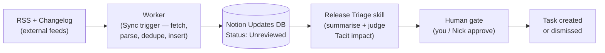

# How to Stay Current with Notion

**Notion ships major updates every 2–4 weeks — here's how to track them**

A guide to keeping pace with the platform TacitOS runs on — which sources to watch, what to set up, and how to automate the whole loop once workspace access lands.

> **How to read this**
> - **Just want the habit?** → sections 1–4: the sources and the 15-minute weekly check. That's all you need to start.
> - **Want the automation design?** → sections 6–7: the Release Watch system — Worker, triage skill, database schema, build order.
> - **Need context on what's shipped?** → section 5: the Sep–Oct 2026 release timeline.

> **Analogy:** Tracking Notion updates is like following a fast-moving sports league. The official site (notion.com/releases) is the league's own scoreboard — authoritative but dry. Matthias Frank's tracker is the dedicated fan blog — every play logged and explained, with an RSS feed so updates come to you. The developer changelog is the rulebook — only matters when you're playing (building). Set up a 'Notion Updates' page in the workspace as your own scrapbook — clip what matters, note whether it affects TacitOS, and it becomes part of the handover record.

> **Current status (Oct 26, 2026) — Release Watch is LIVE:**
> - ✅ Worker **deployed** — `release-watch`, polls every 6h, first real sync wrote 10 rows
> - ✅ 'Notion Updates' database live under *TacitOS Docs → Operations* — 16 rows, triage pipeline working
> - ✅ Release Triage skill v0.2.0 — created in workspace, **validated end-to-end** on the Nov 2 credit row
> - ✅ Changelog database live — logs system changes with reason
> - ⚠️ Feed caveat: `matthiasfrank.de` blocks datacenter IPs (Cloudflare) — Worker uses the **Medium mirror** (`medium.com/feed/@mfreihaendig`); entries are weekly roundups, not individual releases
> - ⏳ GitHub repo — waiting on Tacit org; code is local at `release-watch/`

## Contents

1. Where do official updates land? — primary sources
2. What's the best independent tracker? — Matthias Frank
3. Where does the deeper context live? — blog, community, video
4. What should I set up this week? — the practical habit
5. What shipped recently? — the Sep–Oct 2026 timeline
6. Can the tracking run itself? — the Release Watch system
7. What does the build look like? — database schema, Worker, skill

---

## 1. Where do official updates land? — primary sources

**The point:** Three official channels — check them weekly; together they cover releases, API changes and docs.

- **Notion Releases page** — notion.com/releases — the official changelog. Every versioned release (3.7, 3.8, etc.) gets a dedicated page with full feature lists. The source of truth.
- **Notion Developer Changelog** — developers.notion.com/page/changelog — API-level changes (new properties, MCP tools, SDK versions). Important for anything built with Workers or the API.
- **Notion Help Center** — notion.com/help — feature documentation updated as features ship. Search for the feature name when something new appears.

---

## 2. What's the best independent tracker? — Matthias Frank

**The point:** One independent tracker logs every update with explanations and an RSS feed — subscribe once and updates come to you.

- **Matthias Frank's Notion Updates** — matthiasfrank.de/en/notion-updates/ — 160+ entries, every update logged and explained, with an RSS feed. Also publishes a Weekly Notion Roundup on Medium (medium.com/@mfreihaendig). The single best independent tracker — Nick already pointed you at his channel.

---

## 3. Where does the deeper context live? — blog, community, video

**The point:** For the *why* behind features and early warning on bugs — dip in when a release matters, not weekly.

- **Notion blog** — notion.com/blog — launch posts with the reasoning behind features.
- **Notion Coach** — notioncoach.com/feed — tracks releases with status, plan requirements and practical notes.
- **Notion YouTube** — official channel for feature demos and trailers.
- **Notion Community** — notion.com/community — user discussions; surfaces edge cases and bugs before official docs.

---

## 4. What should I set up this week? — the practical habit

**The point:** Four small actions give you full coverage — RSS subscription, a bookmark, a changelog habit when building, and a workspace page to log what matters.

- **Subscribe to Matthias Frank's RSS** — paste the feed URL into any reader; updates arrive as published.
- **Bookmark notion.com/releases** — check weekly; Notion ships major updates roughly every 2–4 weeks.
- **Watch the developer changelog** if you start building Workers — API changes affect what you can do.
- **Set up a 'Notion Updates' page in the Tacit workspace** — log relevant changes as they ship, with a note on whether they affect TacitOS. This becomes part of the handover documentation (Item 5) and proves you're tracking the platform the system depends on.

---

## 5. What shipped recently? — the Sep–Oct 2026 timeline

**The point:** Six weeks that rebuilt the platform's AI layer — skills became a platform, agents got rebuilt, and the credit model changed underneath everything.

| Date | Release | What it brought |
|---|---|---|
| Sep 9, 2026 | Model controls | Admins control which AI models agents can use |
| Sep 15, 2026 | Notion 3.7 — Agent skills | Skills 2.0 library, Skills API, SKILL.md export, sub-agents, meeting-triggered agents, embedded agents, Agent SDK public beta |
| Oct 13, 2026 | Notion 3.8 — Context for your agents | MCP overhaul (150+ connections), column permissions shipped, synced databases rebuilt (GitHub/Jira/Salesforce), version history upgraded, ChatGPT plan integration, Connections settings redesigned |
| Oct 19, 2026 | Agents rebuilt | Agents get own computer/browser, 24-hour tasks, 'Review for me' mode, Auto model router (~90% cheaper), BYOK (ChatGPT plan live; API keys in Enterprise alpha), new Standard/Select credit system, AI Command Center announced |
| Nov 2, 2026 | Credit system effective | New Standard/Select/Notion credit model takes effect for existing workspaces |

> **The cadence to expect:** a versioned release (3.x) roughly every 4–6 weeks, feature drops between them, and developer/API changes continuously. A 15-minute weekly check of the releases page plus the RSS feed covers it.
>
> *This table is a snapshot for context — the live, growing list is the **Notion Updates** database (Operations), which the Worker keeps current once deployed.*

---

## 6. Can the tracking run itself? — the 'Release Watch' system

**The point:** A Worker polls the feeds and files new releases into a database; a skill judges whether each matters to Tacit; a human signs off. Machine clips, researcher annotates, editor approves.

> **Analogy:** Like a newspaper clipping service. A machine scans the feeds and snips out every new story (the Worker — cheap, tireless, no judgement). A researcher reads each clipping and writes 'why this matters to us' in the margin (the skill — interpretation). An editor signs off before anything goes in the archive (the human gate).

### The live artifact — a Notion Updates database

A Worker can't edit a PDF on a laptop — so the living tracker is a **'Notion Updates' database inside the Tacit workspace**, and the PDFs get regenerated occasionally as snapshots. The database is the source of truth; the docs are exports.

### Layer 1 — the Worker (deterministic)

- **Sync trigger**, e.g. every 6 hours: poll **Matthias Frank's RSS feed** (XML — trivially parseable, no scraping) and optionally the developer changelog.
- **Dedupe** — compare each entry's URL/date against existing rows in the Updates database.
- **Insert new rows** — Date | Title | Link | Source | Status: Unreviewed.
- **Pure code** — fetch, parse, dedupe, insert. Cheap, versioned in the Tacit repo — exactly what Workers are for.

### Layer 2 — the skill (judgement)

- **'Release Triage' skill** — run over the Unreviewed rows: summarise each release in two lines, then judge **Tacit impact** — does it touch TacitOS? Which part: skills, permissions, the money chain, Workers?
- **Output** — a Relevance field (High / Medium / Awareness) plus a written impact note; High items create a Task or flag Nick.
- **Why AI and not code** — 'does this affect Tacit?' is an interpretation call, not a deterministic one.

### Layer 3 — the human gate

- You or Nick reviews the triaged entries — the same review-gate principle as the Nimbus pattern. The machine proposes; a person disposes.

### Who does what — user vs system

| Step | Who | What happens |
|---|---|---|
| Poll feeds every 6h | ⚙️ SYSTEM (Worker) | `release-watch` fetches the Medium RSS, dedupes by URL, upserts new rows |
| Assess impact | 🤖 AI (skill) | *Release Triage* skill: reads each new row, fetches the release, writes impact note + Relevance + Affects, marks Triaged |
| Create follow-up task | 🤖 AI (skill) | High-relevance rows → linked task in Work Tracker (never duplicates) |
| Review & approve | 🧑 USER (you / Nick) | Read the assessment → Actioned or Dismissed → fill `Reviewed by` |
| Implement | 🧑 USER | The linked task gets done through normal work |
| Record | 🧑 USER | Meaningful changes get a Changelog row (what / why / who) |

The boundary: **the system collects and proposes; humans decide and record.** The AI never marks Actioned/Dismissed; the Worker never judges.

### What it needs

| Requirement | Status |
|---|---|
| Business plan (Workers) | Tacit needs it anyway for column permissions — same plan |
| A 'Notion Updates' database | Quick to create — becomes part of the handover hub |
| ntn CLI + repo | Same setup as the other Tier 1 Workers |
| RSS feed URL | Free — matthiasfrank.de/en/notion-updates/ |

### Two honest caveats

- **No official releases API** — notion.com/releases is a marketing page, so parsing it is scraping (fragile). The RSS feed and developer changelog are stable formats — better targets. The releases page itself could be a monthly agent task: an agent with a browser can read a web page and tolerate layout changes.
- **Scheduling** — the Sync Worker handles polling; triage could be a scheduled Custom Agent (Select credits) or a weekly manual skill run — one run, batch-review the week's rows, cheaper.

---

## 7. What does the build look like? — database schema, Worker, skill

**The point:** Everything needed to implement Release Watch — the schema to create, the code shape to write, the skill outline to draft — designed, not yet built.

### The 'Notion Updates' database schema

| Property | Type | Notes |
|---|---|---|
| Title | Title | Release headline |
| Release date | Date | From the feed entry |
| Link | URL | Source URL — also used as the dedupe key |
| Source | Select | MF Updates RSS / Dev Changelog / Releases page / Manual |
| Status | Status | Unreviewed → Triaged → Actioned / Dismissed |
| Relevance | Select | High / Medium / Awareness — set by the triage skill |
| Tacit impact | Text | The skill's written note: which part of TacitOS it touches |
| Affects | Multi-select | Skills / Permissions / Money chain / Workers / Automations / Sharing / Memory / Other |
| Follow-up task | Relation | Link to Tasks DB — created for High relevance |
| Reviewed by | Person | Who signed off (the human gate) |

### The Worker — pseudocode

A Sync-trigger Worker written in TypeScript, deployed via ntn. The shape:

| Step | What the code does |
|---|---|
| 1. Fetch | GET the RSS feed(s) — MF Updates first, dev changelog optionally |
| 2. Parse | XML → list of {title, url, pubDate} entries |
| 3. Dedupe | Query the Updates DB for rows where Link = url; skip any already present |
| 4. Insert | For each new entry: upsert row with Title, Release date, Link, Source — Status left empty (native field; the triage skill treats empty-or-Unreviewed as its input) |
| 5. Log | Write a run record (entries found, added, errors) — the audit trail |
| 6. Alert | If N new rows arrived: post a Notion notification or trigger the triage path |

- **Error handling** — if the feed is unreachable, log the failure and exit cleanly; a missed run is picked up next cycle, not retried into a wall.
- **Idempotent by design** — dedupe on URL means running it twice adds nothing; safe to schedule aggressively.
- **Notion-Version header** — pin the API version in code so a platform API change can't silently alter behaviour.

### The 'Release Triage' skill — outline

- **Trigger** — weekly manual run (cheapest), or a scheduled Custom Agent (Select credits) once trust is established.
- **Instructions (lean, per skill-engineering rules)** — the goal ('turn raw release entries into assessed Tacit-impact notes'), the output format (Relevance + impact note + Affects tags + optional task), the relevance bar (High = touches skills/permissions/money chain/Workers; Awareness = ecosystem noise).
- **Process** — read each Unreviewed row → fetch the linked release → write the two-line summary + impact → set Relevance/Affects → High items get a Tasks-DB row → mark Triaged.
- **Human gate** — Reviewed-by is a person field; the skill proposes, it doesn't action.

### Build order — and where it stands

- [x] **Identify the source** — MF Updates RSS feed verified live and parseable.
- [x] **Create the Updates database** — schema imported via CSV (`Notion_Updates.csv`), seeded with the timeline rows, Status pipeline (Unreviewed → Triaged → Actioned/Dismissed) configured.
- [x] **Scaffold + implement the Worker** — `release-watch/` in the TacitOS repo: RSS parsing isolated in `src/rss.ts`, sync-shaped `src/index.ts`, dry-run script confirmed 10 real entries from the live feed.
- [x] **API connection + share** — internal connection "TacitOS" created; docs hub + Updates DB + Changelog shared with it.
- [x] **Deploy + schedule** — `ntn workers deploy`, `releaseWatch` sync on a 6h schedule; first real run wrote 10 rows.
- [x] **Release Triage skill** — v0.2.0 live in the workspace, validated end-to-end on a real row.
- [ ] **GitHub repo** — push `release-watch/` to the Tacit org once Nick creates it.
- [ ] **Weekly triage routine** — run the skill each week over new rows; human gate reviewed by a person; then routine.

### Deployment lessons (worth keeping)

- **Datacenter IPs get blocked** — `matthiasfrank.de` sits behind Cloudflare bot protection; it 403s requests from Notion's sandbox (works fine from a laptop). Fix: poll the Medium mirror (`medium.com/feed/@mfreihaendig`) — same author, non-walled host. Trade-off: entries are weekly roundups, not one-per-release.
- **Sync-declared properties are read-only** — any property in the worker's schema becomes sync-owned and locked to humans. Declare only what the sync fetches; everything human/skill-owned (Status, Relevance, Tacit impact, Affects, Reviewed by, Follow-up task) stays native. The deploy migration demoted the wrongly-declared fields back to native without losing data — but don't rely on that twice; back up before schema changes (`release-watch/backups/`).
- **Two auth levels** — the integration token (`NOTION_API_TOKEN`) does API reads/writes, but `ntn workers deploy` needs a *user* login (`ntn login` browser flow).

> **Why it matters for Tacit:** An ideal first real Worker: read-only against external feeds, writes only to a new Updates database — nothing touches the money chain. A low-risk M1 warm-up before the financial waterfall, and it produces the handover-ready tracking system as a by-product.

---

## Who uses this, and how

| Who | Access | How they use Release Watch |
|---|---|---|
| **You (operator)** | Full edit | Weekly: run the *Release Triage* skill over new rows → review its judgement → Actioned or Dismissed. ~10–15 min/week. Also writes Changelog rows for meaningful changes. |
| **Nick (CEO)** | Can comment / view | Opens the **Board view** to see the pipeline at a glance (Unreviewed → Triaged → Actioned). Asks Notion AI questions — *"what shipped this week?"*, *"what's unreviewed?"*, *"is anything high-impact?"* — AI answers from the live DB. No edits needed. |
| **Team members** | View on shared docs | Use the docs hub for platform knowledge (KB, Jargon decoder); see the tracker board for what's in flight. |
| **Successor** | Full edit | Inherits the whole loop: docs hub for context, Changelog for history, `SKILL.md` for the judgement contract, repo for code. Runs the same weekly routine. |
| **Notion AI users** | Respects page permissions | Anyone who can *view* a page can ask AI about it; only those with *edit* can have AI write. So sharing the DB read-only is safe — people get answers, not write access. |

The system's division of labour: **the Worker collects, the skill annotates, the human decides** — everyone else just benefits from the record.

---

## Where things live

- **Live data** — *Notion Updates* database, under `TacitOS Docs → Operations` (Table + Board views).
- **Deployed worker** — `release-watch` in the Tacit Padel workspace (`ntn workers list`); sync `releaseWatch` on a 6h schedule.
- **Source code** — `release-watch/` locally → moves to the Tacit GitHub org once created.
- **Triage skill** — `release-watch/skills/release-triage/SKILL.md` (canonical) + workspace skill page (mirror, v0.2.0).
- **Audit trail** — *Changelog* database under Operations; backups in `release-watch/backups/`.
- **Import file** — `Notion_Updates.csv` — used to seed the database; kept for schema reference.
- **Work items** — *TacitOS Work Tracker* — High-relevance updates get a task linked via the `Follow-up task` relation (re-add in the UI after sharing the tracker with the connection).

---

*How to Stay Current with Notion — companion to the Notion General Knowledge Base. Working document, November 2026.*
