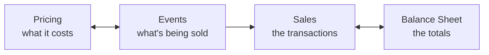
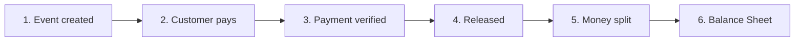

# TacitOS — System Map

**Generated from live schema dumps · Oct 26, 2026** · Source: `system-map/dumps/*.json`

This document explains how money moves through the Tacit Padel workspace — from a customer paying to the balance sheet updating. Everything here was mapped from the real databases, not from assumptions.

---

## 1. The four databases

Four databases carry the money. Each has a simple job:

| Database | What it is | Size |
|---|---|---|
| **TP: Pricing** | The price lists — what a lesson, clinic, or package costs | 46 properties |
| **TP: Events** | The sellable things — a course, clinic, or session a customer books | 42 properties |
| **TP: Sales** | The transactions — one row per sale, with all the pay math inside | 195 properties |
| **TP: Balance Sheet** | The ledger — where the money totals land | 65 properties |

**Notably absent:** there is no *People* or *Customers* database. Coach and payee identity lives inside Sales rows as fields, not as its own table.

---

## 2. How money flows



In plain terms:

1. An **event** is linked to a **price list** (what it costs).
2. When someone pays, a **sale** is created against that event.
3. Inside the sale, formulas split the money: coach fee, court cost, club share, Tacit share, VAT, wallet credit.
4. The **balance sheet** adds up all the sales.

---

## 3. The workflow — step by step



| Step | Who does it | What happens | Where it lives |
|---|---|---|---|
| 1. Event created | 🧑 User (Basil skill) | An event is created and linked to a price list | Events — `Published Price List`, `Sale Type` |
| 2. Customer pays | 🧑 User (Basil skill) | A sale row is created and pointed at its event | Sales — `Events`, `Target Financial Unit` |
| 3. Payment verified | 🧑 User + 🤖 Polly + ⚙️ Worker | Payment is confirmed and the Worker fills the verified fields | Sales — `Payment Verified By`, `Payment Verified At` |
| 4. Released | ⚙️ System | The sale unlocks for financial processing | Sales — `Financial Release Ready` |
| 5. Money split | ⚙️ System | 60 formulas split the money: coach, court, club, Tacit, VAT, wallet | Sales — the waterfall |
| 6. Balance Sheet | ⚙️ System | Totals land in the ledger | Balance Sheet — `Revenue`, `Cost`, `+/-` |

**Steps 1–3 involve humans and skills. Steps 4–6 are automatic.** The only manual gate is step 3 — confirming the payment arrived.

---

## 4. What the data actually shows

The workflow above is the *designed* path. But a sample of 100 sales rows (Oct 26) shows most rows never take it:

| Signal | Observed | What it means |
|---|---|---|
| Payment verified | 3 of 100 | The verification gate is almost never used |
| Released without verification | 93 rows | Money flows through unverified |
| On the new V1 flow | 37 rows | Only ~1/3 of sales use the new path |
| Financial routing set | 27 rows | Only a minority get full routing |

**The same split appears across all three databases:**

| Database | V1 signal | V1 count | V0 count |
|---|---|---|---|
| TP: Sales | `Financial Route = Payment V1` | 37 | 63 |
| TP: Events | Price list linked | 35 | 65 |
| TP: Balance Sheet | Sales linked | 44 | 56 |

**What this means:** the system runs two generations at once — an older ungated path (most rows) and the new V1 gated path (the minority). The migration is incomplete. Any change must handle both generations.

---

## 5. The V1 payment flow in detail

Step 3 isn't purely manual — it's agent-assisted. From the *Polly: Payment Manager* skill page:

```
Operator confirms payment details with Polly
  → Polly writes a JSON instruction into the Event Log
  → The "Payment V1 — Process Event" automation fires
  → The deployed Worker (tacit-payment-v1) fills the verified fields
  → Polly re-reads the Event and confirms to the operator
```

So the 93% "unverified" rows are **legacy sales that predate this flow**, not a broken gate. The real question: backfill the old rows onto V1, or let them age out?

---

## 6. The deployed Worker — `tacit-payment-v1`

From the *Payment V1 Deployed Worker Contract* doc:

- **Worker ID:** `01a11753-b9c9-72d8-8553-09ee8fc836c3`
- **Trigger:** the native "Payment V1 — Process Event" automation fires when Event Status = `Payment Processing`
- **What it does:** creates or reuses Revenue/Cost Sales and linked Balance Sheet outcomes; decides the financial split
- **Preconditions:** a Pending Event in `Financial Route = Payment V1`; a released product; exact Event + attendee IDs; required relations (attendee, coach, organisation, area, active price list); a unique operation key; explicit operator confirmation
- **Legacy trigger:** "TP: Sales Ready to process" is a legacy/manual trigger — **not** the V2 route
- **Hard rule:** the Worker is the *only* component that creates financial outcomes. A hold, a duplicate, or a stale state is never a reason for a manual financial record.

---

## 7. The operating boundary

From the *Booking & Payment Operating Boundary* doc:

- **Source order:** inspect the exact Event and payment evidence → load the Worker Contract → use released-route context → use historical canary evidence. If facts conflict, hold.
- **Basil:** creates one confirmed Payment V1 Event in Pending status, verifies it, hands its URL to Polly
- **Polly:** independently re-reads the Event, asks Paid/Promo/Wallet, writes the JSON instruction
- **Worker:** the only component that creates Sales and Balance Sheet outcomes
- **Released products:** Private Lesson, Match with Coach, Clinic, Coaches Academy, Play with Coach. Wallet funding is released. Player Academy, refunds, and cancellations are NOT released.
- **Authority:** the Event, its payment evidence, and the observed Worker result outrank every summary page.

---

## 8. Skills in the money chain

| Skill | Status | Role |
|---|---|---|
| **Basil: Booking Manager** | ✅ Live | Event/sale creation (steps 1–2); 5 released products |
| **Polly: Payment Manager** | ✅ Live | V1 payment intake + verification (step 3); writes the JSON instruction |
| **Felix: Financial Flow** | ⚠️ Live, planning-only | Defines waterfall changes but never executes; requires change request + owner + canary + rollback |
| **Alan: Accountant** | 🔴 Draft, not live | Reviews/reconciles Balance Sheet; not authorized to change records |

### Full skills registry (14 skills in the AI: L3 Skills DB)

**Money chain:** Basil (booking), Polly (payment), Felix (financial flow), Alan (accountant)

**System/integration:** Warren (Worker engineer), Sally (integration reviewer), Tess (technical trace), Walter (workspace wiring), Imogen (integration integrity)

**Work management:** Tasmin (tasks), Peter (projects), Clara (change), Curtis (capability)

**Meta:** Soren (skill builder), Design Tacit Graphics

---

## 9. Every cross-database link

| From | Property | To | Two-way? |
|---|---|---|---|
| TP: Events | Published Price List | TP: Pricing | ✅ |
| TP: Events | Sub / Parent Event | TP: Events | self-hierarchy |
| TP: Sales | Events, Target Financial Unit | TP: Events | one-way |
| TP: Sales | Price List | TP: Pricing | one-way |
| TP: Sales | Balance Sheet | TP: Balance Sheet | ✅ |
| TP: Sales | Group / Item / Wallet 2 | TP: Sales | self-hierarchy |
| TP: Balance Sheet | Sales | TP: Sales | ✅ |
| AI: (L3) Skills | References | AI: (L4) References | ✅ |

Isolated (no outbound relations): TP: FX Rates, TP: Social Posts, Tacit 2.0 migration.

---

## 10. Database inventory

| Database | Props | Relations | Formulas | Rollups | Role |
|---|---|---|---|---|---|
| **TP: Sales** | 195 | 9 | **60** | 5 | The core — heaviest logic |
| TP: Balance Sheet | 65 | 4 | 8 | 2 | Where money lands |
| TP: Pricing | 46 | 4 | 1 | 0 | Price lists |
| TP: Events | 42 | 4 | **14** | 0 | The financial unit |
| TP: Social Posts | 30 | 1 | 2 | 0 | Content pipeline |
| TP: Schedules | 24 | 3 | 6 | 0 | Scheduling |
| AI: (L3) Skills | 23 | 4 | 1 | 0 | Skills registry |
| AI: (L4) References | 21 | 4 | 1 | 0 | Skill references |
| AI: (L2) Routing | 15 | 3 | 1 | 0 | Routing layer |
| TP: DB Template | 14 | 3 | 1 | 0 | Template |
| TP: FX Rates | 10 | 0 | 0 | 0 | Standalone reference |
| Tacit 2.0 migration | 5 | 0 | 0 | 0 | Migration stub |

---

## 11. Issues found

1. **Sales is a monolith** — 195 properties in one table: inputs, computed logic, wallet state, and UI strings. Any change risks collateral damage.
2. **Business logic lives in formulas, not data** — the revenue waterfall is 60 formula expressions; there is no rate-card or rules table to inspect.
3. **A parallel "shadow" system overlaps the live one** — `Shadow Validation State`, `Shadow Coach Fee Basis`, `Financial Route: Legacy / Payment V1`. The V1→V2 migration is in progress; unclear which fee model is authoritative.
4. **Presentation logic inside the data model** — `UI: ①–⑱` formulas re-render computed values as text; they leak values even if inputs are hidden.
5. **Ad-hoc row permissions as data** — `Can View / Can Edit / Can Comment` are people properties — access control stored as content, not real permissioning.
6. **Self-relations simulate hierarchy** — Group/Item, Wallet 2/Item, Parent/Sub Event model parent-child via self-links.
7. **No People/Customers DB** — no single source of truth for coach/person identity or rates.
8. **Stalled migration artifact** — "Tacit 2.0 migration" DB has 5 props and no relations — likely abandoned.
9. **V0/V1 migration incomplete** — ~65% of sales are on the legacy path; ~35% on V1. Both generations must be supported until migration completes.

---

## 12. What this means for hiding pay columns

- **The money chain is a chain, not columns** — 41 of Sales' 60 formulas read money-named fields, including each other's outputs: List Price → Academy Fees → Net Sales → Gross Profit → OPEX/Community/Dividends → Balance Sheet.
- **Hiding one pay column breaks the waterfall** — every mid-chain field feeds formulas downstream.
- **Hiding inputs but not the display layer still leaks** — `UI: ①–⑱` re-render values as text.
- **Viable directions:** row-level restriction, complete-layer hiding, or aggregate-only views. Test plan: `permission-test-matrix.md` (sandbox only — never live).

---

## 13. The AI layer (separate chain)

`AI: (L3) Skills → References → (L4)`, `AI: (L2) Routing` — self-contained triad; auditable independently of the money chain.

---

*Regenerate: re-run the dump script when schemas change. Detailed per-property references: `tp_sales.md`, `tp_events.md`, `tp_balance_sheet.md`.*
